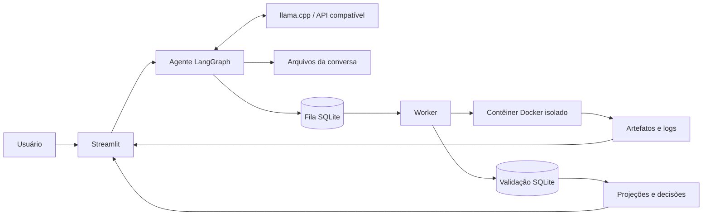

# Qwen Homelab

> A classificação de entradas, o gate de execução Python, a aprovação humana,
> a detecção de ofuscação/Base64 e a auditoria estão documentados em
> [SECURITY_GUARD.md](SECURITY_GUARD.md).

Interface local para conversar com modelos servidos pelo `llama.cpp`, processar documentos e executar código Python em contêineres isolados.

O projeto combina Streamlit, LangGraph, SQLite e Docker em uma aplicação voltada para uso pessoal em homelab. Cada conversa possui arquivos, histórico e tarefas próprios. O modelo pode ler e produzir artefatos, converter PDFs e páginas HTML, pedir esclarecimentos e enfileirar scripts sem executar código diretamente no processo da interface.

> [!IMPORTANT]
> A interface não possui autenticação. Use-a apenas em uma rede confiável e não exponha a porta do Streamlit diretamente à internet.

## Recursos

- Chat com uma API compatível com OpenAI, testado com `llama.cpp` e Qwen.
- Conversas persistentes, isoladas e renomeáveis.
- Upload e download de arquivos pelo navegador.
- Conversão de PDFs e páginas HTML para Markdown.
- Ferramentas para leitura, busca e gravação de texto e código.
- Fila persistente de execuções em SQLite.
- Contratos de validação congelados antes de cada tentativa.
- Verificação automática separada da aceitação humana.
- Log de eventos append-only com idempotência e controle de concorrência.
- Execução Python em contêineres Docker sem rede.
- Limites de CPU, memória, processos, tempo, logs e artefatos.
- Acompanhamento de tarefas sem manter o navegador aberto.
- Perguntas com opções clicáveis antes de continuar uma tarefa.
- Exportação individual de arquivos, pacote ZIP e histórico JSON.

## Arquitetura



O Streamlit cuida da interface e da persistência das conversas. O agente usa ferramentas com caminhos limitados ao workspace da conversa. Scripts Python são registrados na fila e executados por um worker separado dentro do Docker. O worker registra tentativas, manifestos e evidências em um protocolo de validação independente do estado operacional da fila.

## Requisitos

- Linux.
- Python 3.10 ou superior.
- Docker acessível pelo usuário atual.
- `llama.cpp` com `llama-server`, ou outra API compatível com OpenAI.
- Um modelo GGUF compatível.
- `tmux`, caso queira iniciar todos os serviços com um único comando.

O script do modelo usa, por padrão:

- executável em `~/llama.cpp/build/bin/llama-server`;
- modelo em `~/models/Qwen3-Coder-Next/Qwen3-Coder-Next-Q4_K_M.gguf`;
- alias `qwen`;
- API em `http://127.0.0.1:8080/v1`;
- 20 threads e contexto de 262.144 tokens.

Todos esses caminhos e valores podem ser configurados por variáveis de ambiente.

## Instalação

Clone o repositório e crie o ambiente virtual:

```bash
git clone https://github.com/rafaelimai/qwen_harness_streamlit.git
cd qwen_harness_streamlit
python3 -m venv .venv
.venv/bin/pip install -r requirements.txt
```

Confira se o Docker está disponível para o usuário atual:

```bash
docker info
```

Construa a imagem usada para executar os scripts:

```bash
bash preparar_executor.sh
```

A imagem local `qwen-harness-runner:1` inclui Python 3.12, NumPy, pandas, Matplotlib e pytest. A construção pode acessar a internet para baixar dependências. As tarefas executadas posteriormente ficam sem acesso à rede.

### Atualização

Depois de baixar uma nova versão do código:

```bash
git pull
.venv/bin/pip install -r requirements.txt
bash preparar_executor.sh
```

Conversas e tarefas ficam em `data/`. Faça backup desse diretório antes de atualizações importantes.

## Início rápido

Com o `llama-server`, o modelo GGUF e o Docker já preparados, execute:

```bash
bash iniciar_tudo.sh
```

O inicializador cria uma sessão `tmux` com o modelo, o worker, o supervisor passivo, o coordenador de turnos e a interface. A interface sobe imediatamente; a aba **Sistema** permite acompanhar o carregamento até a API do modelo ficar pronta. Acesse o endereço exibido no terminal, normalmente:

```text
http://IP_DO_HOMELAB:8501
```

Comandos de operação:

```bash
# Consultar os serviços
bash iniciar_tudo.sh status

# Abrir a sessão tmux
bash iniciar_tudo.sh attach

# Encerrar todos os serviços gerenciados pela sessão
bash encerrar_tudo.sh
```

No `tmux`, use `Ctrl+B` seguido de `N` para mudar de janela e `Ctrl+B` seguido de `D` para desconectar. Os processos continuam ativos depois que a sessão SSH é encerrada.

### Usar uma API já existente

Defina o endereço e o alias antes de iniciar. A API deve responder ao endpoint `/models`:

```bash
export LLAMA_BASE_URL=http://127.0.0.1:8080/v1
export LLAMA_MODEL=qwen
bash iniciar_tudo.sh
```

Quando a API configurada já está disponível, o inicializador a reutiliza e não abre outra instância do modelo.

### Iniciar os componentes separadamente

Use três terminais ou sessões `tmux`:

```bash
# Terminal 1
bash iniciar_modelo.sh

# Terminal 2
bash iniciar_worker.sh

# Terminal 3
bash iniciar_interface.sh
```

A interface pode funcionar sem o worker para conversar, organizar arquivos e converter documentos. As execuções Python permanecem na fila até que o worker esteja ativo.

## Uso

Um pedido completo pode ser feito diretamente no chat:

> Crie `work/exemplo.py` usando apenas a biblioteca padrão. Gere `outputs/resultado.csv` com os quadrados de 1 a 10, imprima um resumo e execute o script.

O agente grava o script e enfileira a execução. A conversa exibe estado, saúde operacional, validação e o estado da continuação; a aba **Tarefas** mantém logs, artefatos e detalhes. Quando resultado, manifesto e estado conhecido de validação alcançam a barreira `RESULT_READY`, o coordenador retoma o objetivo automaticamente, inclusive com o navegador fechado. **Reanalisar manualmente** permanece como intervenção opcional.

O histórico gravável usa mensagens append-only no `jobs.sqlite3`. `conversation.json` é apenas uma exportação de compatibilidade; conversas antigas são migradas uma vez e recebem o backup `conversation.pre-sqlite.json`.

### Validação dos resultados

Cada job recebe um contrato congelado antes da primeira tentativa. A implementação inicial possui dois critérios obrigatórios:

1. a execução terminou com sucesso, verificado automaticamente pelo estado do worker;
2. o resultado entregue foi aceito pelo usuário, decidido na aba **Tarefas**.

Por isso, uma execução bem-sucedida não é aprovada automaticamente. Ela normalmente termina com:

```text
acceptance_status = PENDING
verification_status = PARTIALLY_VERIFIED
approved = false
```

Na aba **Tarefas**, cada critério apresenta seu estado de aceitação, sua verificação independente e o efeito de eventual decisão humana. Os controles disponíveis são:

- **Aceitar:** define o critério como `ACCEPTED`;
- **Rejeitar:** define o critério como `REJECTED`;
- **Usar evidência:** remove a intervenção efetiva e volta ao estado derivado da evidência.

A interface também informa `approval_basis` (`AUTOMATED_ONLY`, `MIXED`, `HUMAN_ONLY` ou `NONE`) e `human_review_status`. Uma decisão humana pode aprovar um critério refutado, mas não altera nem apaga a evidência original.

O protocolo completo, incluindo identidade, rodadas, reducers, invariantes e pontos deliberadamente adiados, está em [`contrato_validacao_maquina_estados_harness.md`](contrato_validacao_maquina_estados_harness.md).

Cada conversa usa três diretórios principais:

```text
inputs/    arquivos enviados pelo usuário
work/      scripts e arquivos de trabalho
outputs/   relatórios e resultados publicados
```

Os resultados de uma tarefa ficam em `outputs/jobs/<job_id>/`. O snapshot usado pela tarefa permanece associado ao job para auditoria.

## Ferramentas do agente

| Ferramenta | Função |
| --- | --- |
| `list_files` | Lista arquivos em `inputs/`, `work/` e `outputs/` |
| `ingest_document` | Converte um PDF enviado ou uma página HTML para Markdown |
| `read_file` | Lê um trecho de texto, código ou log |
| `search_files` | Faz busca textual nos arquivos da conversa |
| `write_file` | Grava texto em `work/` ou `outputs/` |
| `save_markdown` | Grava um relatório Markdown em `outputs/` |
| `run_python` | Enfileira um script `.py` existente em `work/` |
| `get_job_status` | Consulta estado, logs, código de saída e artefatos |
| `cancel_job` | Cancela uma tarefa na fila ou em execução |
| `ask_user` | Interrompe o turno e exibe uma pergunta com até 4 alternativas mais “Outros” |

As chamadas são serializadas. Uma pergunta feita com `ask_user` tem prioridade e encerra o turno para que o usuário responda antes da continuação. A interface acrescenta “Outros” automaticamente; ao selecioná-la, abre um campo de texto livre antes do envio.

Cada resposta a `ask_user` também é preservada em `decisions.json`, com pergunta, alternativas, escolha e horário. A interface apresenta esse histórico em **Rastreio de escolhas**. O agente recebe as escolhas anteriores como contexto para formular perguntas dependentes, evitar repetição e pedir confirmação quando uma resposta nova parecer contradizer uma decisão anterior; nenhuma versão é apagada silenciosamente.

Quando uma pergunta oferece alternativas, a harness faz uma única consulta adicional à LLM para pré-calcular a possível próxima pergunta de cada ramificação. As respostas válidas ficam em `question-cache.json`. Depois da escolha do usuário, a ramificação correspondente pode ser exibida sem uma nova inferência principal; falhas ou respostas inválidas no pré-cálculo apenas descartam a otimização e preservam o fluxo normal. A conversa também solicita rolagem suave para o conteúdo mais recente após cada atualização.

Perguntas relacionadas são encapsuladas em ciclos persistidos em `question-cycles.json`. Ao abrir um ciclo, a LLM declara seu objetivo e a `definition-of-done`; a interface mostra esses critérios e a quantidade de perguntas realizadas. Enquanto houver critério pendente, o agente apresenta uma pergunta por turno. Quando deixa o modo de perguntas para retomar ferramentas ou responder conclusivamente, a harness marca o ciclo como concluído. Uma necessidade posterior abre um novo ciclo sem apagar os anteriores.

## Isolamento das execuções

Cada tarefa recebe um snapshot de `inputs/`, `work/` e `outputs/`. O snapshot é montado como somente leitura em `/source`. O script roda em um `tmpfs` separado, com diretório atual `/work` e uma pasta `outputs/` inicialmente vazia.

O contêiner usa:

- rede desabilitada;
- filesystem base somente leitura;
- usuário `1000:1000`;
- todas as capabilities removidas;
- `no-new-privileges`;
- limite de 2 CPUs e 2 GiB de memória;
- limite de 64 processos;
- nenhum socket Docker, diretório pessoal ou segredo do host.

| Controle | Limite |
| --- | ---: |
| Tempo padrão do script | 120 segundos |
| Faixa permitida de tempo | 1 a 600 segundos |
| Workspace temporário | 256 MiB |
| Diretório `/tmp` | 32 MiB |
| Logs | 4 MiB por fluxo |
| Artefatos coletados | 64 MiB e 1.000 entradas |
| Snapshot | 128 MiB e 2.000 arquivos |
| Arquivo textual gravado | 2 MiB |

Somente arquivos regulares dentro de `outputs/` são publicados. Links simbólicos, arquivos especiais e caminhos que escapem do destino são rejeitados.

> [!NOTE]
> O contêiner compartilha o kernel do host. O isolamento foi projetado para uma ferramenta pessoal em homelab e não para oferecer execução pública de código hostil.

## Configuração

| Variável | Padrão | Finalidade |
| --- | --- | --- |
| `HARNESS_DIR` | diretório dos scripts | Local da aplicação |
| `HARNESS_DATA_DIR` | `<projeto>/data` | Conversas, fila, snapshots e logs |
| `HARNESS_TMUX_SESSION` | `qwen-harness` | Nome da sessão `tmux` |
| `LLAMA_BASE_URL` | `http://127.0.0.1:8080/v1` | Endpoint da API do modelo |
| `LLAMA_MODEL` | `qwen` | Alias informado ao cliente |
| `LLAMA_SERVER` | `~/llama.cpp/build/bin/llama-server` | Executável do servidor |
| `MODEL_PATH` | `~/models/Qwen3-Coder-Next/Qwen3-Coder-Next-Q4_K_M.gguf` | Arquivo GGUF |
| `THREADS` | `20` | Threads usadas pelo `llama-server` |
| `CONTEXT` | `262144` | Tamanho do contexto |
| `PORT` | `8501` | Porta da interface Streamlit |
| `HARNESS_RUNNER_IMAGE` | `qwen-harness-runner:1` | Imagem Docker do executor |

Use o mesmo `HARNESS_DATA_DIR` e `HARNESS_RUNNER_IMAGE` na interface e no worker. O Docker e os dados precisam estar na mesma máquina porque os snapshots são montados no contêiner.

## Persistência

As conversas ficam em `data/`, junto com os bancos `jobs.sqlite3` e `validation.sqlite3`. `conversation.json` preserva mensagens, chamadas de ferramentas e seus resultados; `session.json` guarda título e os parâmetros de geração usados por aquela conversa (`base_url`, modelo/alias, temperatura e máximo de tokens). Ao reabrir uma conversa, a interface restaura o histórico e esses parâmetros automaticamente. Credenciais não são persistidas.

O banco de validação mantém:

- contratos congelados antes das tentativas;
- eventos append-only com posição global e revisão por stream;
- manifestos de resultado e digests SHA-256 dos artefatos;
- avaliações, rodadas e revisões projetadas;
- decisões humanas vinculadas à rodada vigente;
- estados agregados de aceitação e verificação.

Repetições usam chaves idempotentes. Atualizações concorrentes usam compare-and-swap sobre a revisão do stream; payload diferente com a mesma chave é tratado como conflito.

Decisões, ciclos e perguntas pré-calculadas ficam em arquivos próprios na mesma pasta da conversa. O estado interno do servidor de inferência — como KV cache, seed e flags usadas para iniciar o llama.cpp — não é serializado; portanto, retomar preserva o contexto lógico e a configuração da interface, mas não garante reprodução bit a bit de uma geração anterior.

Cada tarefa registra horários, argumentos, hash do snapshot, estado, logs, artefatos, número da tentativa, token ativo e prazo de tomada de posse.

Estados possíveis:

```text
queued → starting → running → succeeded
                            ↘ failed
                            ↘ cancelled
                            ↘ timed_out
                            ↘ interrupted
```

Cada processo executa uma tarefa por vez, mas vários workers podem consumir a mesma fila. A reivindicação SQLite é atômica e cria um token exclusivo por tentativa. O lease não é renovado: seu vencimento apenas permite que outro worker tome posse; sozinho, ele não invalida o titular atual.

Quando uma nova tentativa toma posse, o token anterior fica obsoleto. Atualizações de estado e conclusão usam um `UPDATE` condicionado ao token ativo, portanto a execução antiga não consegue sobrescrever o resultado. O worker antigo detecta a substituição durante sua consulta periódica e encerra seu próprio contêiner. Containers, logs e diretórios de artefatos também incluem o token da tentativa para não colidirem entre si.

Por padrão, o lease dura o timeout solicitado pela tarefa mais 60 segundos de margem operacional. Uma tarefa em estado terminal não pode ser retomada. A migração do banco ocorre automaticamente; tarefas `starting` ou `running` de versões anteriores, que não tinham lease, tornam-se elegíveis para retomada.

O racional, os cenários concorrentes e a rubrica usados como base de discussão estão em [`proposta_tokens_execucao_harness.md`](proposta_tokens_execucao_harness.md).

## Testes

Instale as dependências de desenvolvimento:

```bash
.venv/bin/pip install -r requirements-dev.txt
```

Execute a suíte local:

```bash
.venv/bin/python -m pytest -q
```

Os testes cobrem conversão de documentos, isolamento de caminhos, persistência SQLite, idempotência, ciclo de ferramentas, interface, limites de artefatos e o lifecycle do worker com um backend simulado. Também exercitam reivindicação e retomada concorrentes com conexões SQLite distintas, expiração sem substituição e fencing do token antigo.

O núcleo de validação possui testes específicos para políticas `ALL`, `ANY` e `QUORUM`, separação entre falha operacional e observação, overrides humanos, base causal da aprovação, revisões append-only, compare-and-swap concorrente e integração completa entre fila, worker e projeção persistida.

Para executar a integração com Docker real:

```bash
bash preparar_executor.sh
bash verificar_executor.sh
```

Esse teste verifica sucesso, falha Python, timeout, cancelamento, snapshot somente leitura, rede bloqueada e coleta de artefatos.

## Estrutura do projeto

```text
.
├── app.py                    interface Streamlit
├── agente.py                 ferramentas e grafo LangGraph
├── ingestao.py               conversão de PDF e HTML
├── storage.py                workspaces e histórico das conversas
├── jobs.py                   fila SQLite e snapshots
├── validation.py             reducers, eventos e projeções de validação
├── worker.py                 execução e lifecycle dos contêineres
├── supervisor.py             detecção passiva e snapshots de incidentes
├── turn_coordinator.py       continuação automática com fencing
├── conversation_store.py     mensagens append-only e leases de conversa
├── sandbox/
│   ├── Dockerfile            imagem do executor
│   └── runner.py             processo interno do contêiner
├── iniciar_tudo.sh           inicialização integrada com tmux
├── encerrar_tudo.sh         encerramento seguro da sessão tmux
├── iniciar_modelo.sh         servidor llama.cpp
├── iniciar_worker.sh         worker da fila
├── iniciar_supervisor.sh     supervisor passivo
├── iniciar_coordenador.sh    coordenador de turnos
├── iniciar_interface.sh      aplicação Streamlit
├── preparar_executor.sh      construção da imagem Docker
├── verificar_executor.sh     integração com Docker real
└── test_*.py                 suíte de testes
```

## Limitações atuais

- Não há autenticação nem autorização por usuário.
- O histórico é persistido, mas o estado interno de um nó LangGraph não possui checkpoint durável.
- A conclusão de uma tarefa não retoma o agente automaticamente.
- Os contratos criados automaticamente para jobs ainda usam dois critérios fixos; geração de critérios específicos a partir do pedido permanece futura.
- O modelo de autoridade ainda considera um único usuário local; papéis e permissões granulares não foram implementados.
- Validadores gerados dinamicamente, isolamento próprio para validadores e evidências externas autoritativas ainda não foram implementados.
- PDFs sem camada de texto precisam de OCR externo.
- A busca em arquivos é textual, sem RAG ou índice semântico.
- Logs e snapshots antigos não possuem limpeza automática.

Consulte [ROADMAP.md](ROADMAP.md) para as próximas capacidades planejadas.

## Dados locais

O diretório `data/` pode conter conversas, documentos, scripts, logs e resultados. Antes de publicar um fork ou enviar alterações, confirme que `data/`, `.venv/`, `__pycache__/` e arquivos de configuração locais não serão incluídos no commit.

## Desenvolvimento

Contribuições devem manter as garantias de contenção de caminhos e isolamento das tarefas. Ao alterar o runner, o worker ou a imagem Docker, execute a suíte local e o teste de integração real.

Antes de enviar uma mudança:

```bash
.venv/bin/python -m pytest -q
bash verificar_executor.sh
```

Ao adicionar dependências disponíveis para scripts gerados, atualize `sandbox/Dockerfile` e reconstrua a imagem.
## Desenvolvimento com assistência de IA

Esta harness foi desenvolvida com uso intensivo de IA para gerar código, testes e documentação, em um processo iterativo de definição de requisitos, implementação e experimentação no homelab.

O projeto também é um laboratório de aprendizado em AI Engineering. Meu trabalho envolve definir o escopo, discutir as decisões de arquitetura, integrar os componentes e investigar os problemas encontrados durante o uso. A compreensão e a validação do código avançam junto com o desenvolvimento.

Os testes automatizados, as verificações realizadas com componentes simulados e as limitações conhecidas estão documentados para distinguir o que foi implementado do que já foi validado em condições reais.
