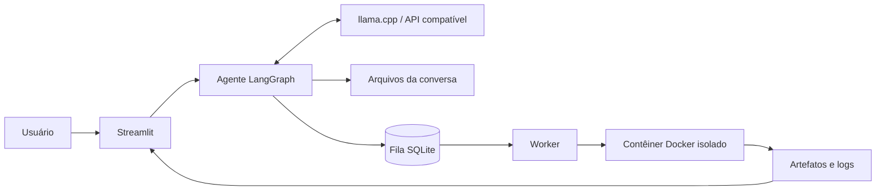

# Qwen Homelab

Interface local para conversar com modelos servidos pelo `llama.cpp`, processar documentos e executar código Python em contêineres isolados.

O projeto combina Streamlit, LangGraph, SQLite e Docker em uma aplicação voltada para uso pessoal em homelab. Cada conversa possui arquivos, histórico e tarefas próprios. O modelo pode ler e produzir artefatos, converter PDFs e páginas HTML, pedir esclarecimentos e enfileirar scripts sem executar código diretamente no processo da interface.

> [!IMPORTANT]
> A interface não possui autenticação. Use-a apenas em uma rede confiável e não exponha a porta do Streamlit diretamente à internet.

## Recursos

- Chat com uma API compatível com OpenAI, testado com `llama.cpp` e Qwen.
- Conversas persistentes, isoladas e renomeáveis.
- Upload e download de arquivos pelo navegador.
- Conversão de PDFs e páginas HTML para Markdown.
- Ferramentas para leitura, busca e gravação de texto e código.
- Fila persistente de execuções em SQLite.
- Execução Python em contêineres Docker sem rede.
- Limites de CPU, memória, processos, tempo, logs e artefatos.
- Acompanhamento de tarefas sem manter o navegador aberto.
- Perguntas com opções clicáveis antes de continuar uma tarefa.
- Exportação individual de arquivos, pacote ZIP e histórico JSON.

## Arquitetura



O Streamlit cuida da interface e da persistência das conversas. O agente usa ferramentas com caminhos limitados ao workspace da conversa. Scripts Python são registrados na fila e executados por um worker separado dentro do Docker.

## Requisitos

- Linux.
- Python 3.10 ou superior.
- Docker acessível pelo usuário atual.
- `llama.cpp` com `llama-server`, ou outra API compatível com OpenAI.
- Um modelo GGUF compatível.
- `tmux`, caso queira iniciar todos os serviços com um único comando.

O script do modelo usa, por padrão:

- executável em `~/llama.cpp/build/bin/llama-server`;
- modelo em `~/models/Qwen3-Coder-Next/Qwen3-Coder-Next-Q4_K_M.gguf`;
- alias `qwen`;
- API em `http://127.0.0.1:8080/v1`;
- 20 threads e contexto de 262.144 tokens.

Todos esses caminhos e valores podem ser configurados por variáveis de ambiente.

## Instalação

Clone o repositório e crie o ambiente virtual:

```bash
git clone https://github.com/rafaelimai/qwen_harness_streamlit.git
cd qwen_harness_streamlit
python3 -m venv .venv
.venv/bin/pip install -r requirements.txt
```

Confira se o Docker está disponível para o usuário atual:

```bash
docker info
```

Construa a imagem usada para executar os scripts:

```bash
bash preparar_executor.sh
```

A imagem local `qwen-harness-runner:1` inclui Python 3.12, NumPy, pandas, Matplotlib e pytest. A construção pode acessar a internet para baixar dependências. As tarefas executadas posteriormente ficam sem acesso à rede.

### Atualização

Depois de baixar uma nova versão do código:

```bash
git pull
.venv/bin/pip install -r requirements.txt
bash preparar_executor.sh
```

Conversas e tarefas ficam em `data/`. Faça backup desse diretório antes de atualizações importantes.

## Início rápido

Com o `llama-server`, o modelo GGUF e o Docker já preparados, execute:

```bash
bash iniciar_tudo.sh
```

O inicializador cria uma sessão `tmux` com o modelo, o worker e a interface. Quando o modelo estiver pronto, acesse o endereço exibido no terminal, normalmente:

```text
http://IP_DO_HOMELAB:8501
```

Comandos de operação:

```bash
# Consultar os serviços
bash iniciar_tudo.sh status

# Abrir a sessão tmux
bash iniciar_tudo.sh attach
```

No `tmux`, use `Ctrl+B` seguido de `N` para mudar de janela e `Ctrl+B` seguido de `D` para desconectar. Os processos continuam ativos depois que a sessão SSH é encerrada.

### Usar uma API já existente

Defina o endereço e o alias antes de iniciar. A API deve responder ao endpoint `/models`:

```bash
export LLAMA_BASE_URL=http://127.0.0.1:8080/v1
export LLAMA_MODEL=qwen
bash iniciar_tudo.sh
```

Quando a API configurada já está disponível, o inicializador a reutiliza e não abre outra instância do modelo.

### Iniciar os componentes separadamente

Use três terminais ou sessões `tmux`:

```bash
# Terminal 1
bash iniciar_modelo.sh

# Terminal 2
bash iniciar_worker.sh

# Terminal 3
bash iniciar_interface.sh
```

A interface pode funcionar sem o worker para conversar, organizar arquivos e converter documentos. As execuções Python permanecem na fila até que o worker esteja ativo.

## Uso

Um pedido completo pode ser feito diretamente no chat:

> Crie `work/exemplo.py` usando apenas a biblioteca padrão. Gere `outputs/resultado.csv` com os quadrados de 1 a 10, imprima um resumo e execute o script.

O agente grava o script e enfileira a execução. A aba **Tarefas** exibe o estado, os logs e os artefatos. Ao final, use **Analisar resultado** para pedir ao modelo uma avaliação da execução.

Cada conversa usa três diretórios principais:

```text
inputs/    arquivos enviados pelo usuário
work/      scripts e arquivos de trabalho
outputs/   relatórios e resultados publicados
```

Os resultados de uma tarefa ficam em `outputs/jobs/<job_id>/`. O snapshot usado pela tarefa permanece associado ao job para auditoria.

## Ferramentas do agente

| Ferramenta | Função |
| --- | --- |
| `list_files` | Lista arquivos em `inputs/`, `work/` e `outputs/` |
| `ingest_document` | Converte um PDF enviado ou uma página HTML para Markdown |
| `read_file` | Lê um trecho de texto, código ou log |
| `search_files` | Faz busca textual nos arquivos da conversa |
| `write_file` | Grava texto em `work/` ou `outputs/` |
| `save_markdown` | Grava um relatório Markdown em `outputs/` |
| `run_python` | Enfileira um script `.py` existente em `work/` |
| `get_job_status` | Consulta estado, logs, código de saída e artefatos |
| `cancel_job` | Cancela uma tarefa na fila ou em execução |
| `ask_user` | Interrompe o turno para solicitar uma informação essencial |

As chamadas são serializadas. Uma pergunta feita com `ask_user` tem prioridade e encerra o turno para que o usuário responda antes da continuação.

## Isolamento das execuções

Cada tarefa recebe um snapshot de `inputs/`, `work/` e `outputs/`. O snapshot é montado como somente leitura em `/source`. O script roda em um `tmpfs` separado, com diretório atual `/work` e uma pasta `outputs/` inicialmente vazia.

O contêiner usa:

- rede desabilitada;
- filesystem base somente leitura;
- usuário `1000:1000`;
- todas as capabilities removidas;
- `no-new-privileges`;
- limite de 2 CPUs e 2 GiB de memória;
- limite de 64 processos;
- nenhum socket Docker, diretório pessoal ou segredo do host.

| Controle | Limite |
| --- | ---: |
| Tempo padrão do script | 120 segundos |
| Faixa permitida de tempo | 1 a 600 segundos |
| Workspace temporário | 256 MiB |
| Diretório `/tmp` | 32 MiB |
| Logs | 4 MiB por fluxo |
| Artefatos coletados | 64 MiB e 1.000 entradas |
| Snapshot | 128 MiB e 2.000 arquivos |
| Arquivo textual gravado | 2 MiB |

Somente arquivos regulares dentro de `outputs/` são publicados. Links simbólicos, arquivos especiais e caminhos que escapem do destino são rejeitados.

> [!NOTE]
> O contêiner compartilha o kernel do host. O isolamento foi projetado para uma ferramenta pessoal em homelab e não para oferecer execução pública de código hostil.

## Configuração

| Variável | Padrão | Finalidade |
| --- | --- | --- |
| `HARNESS_DIR` | diretório dos scripts | Local da aplicação |
| `HARNESS_DATA_DIR` | `<projeto>/data` | Conversas, fila, snapshots e logs |
| `HARNESS_TMUX_SESSION` | `qwen-harness` | Nome da sessão `tmux` |
| `LLAMA_BASE_URL` | `http://127.0.0.1:8080/v1` | Endpoint da API do modelo |
| `LLAMA_MODEL` | `qwen` | Alias informado ao cliente |
| `LLAMA_SERVER` | `~/llama.cpp/build/bin/llama-server` | Executável do servidor |
| `MODEL_PATH` | `~/models/Qwen3-Coder-Next/Qwen3-Coder-Next-Q4_K_M.gguf` | Arquivo GGUF |
| `THREADS` | `20` | Threads usadas pelo `llama-server` |
| `CONTEXT` | `262144` | Tamanho do contexto |
| `PORT` | `8501` | Porta da interface Streamlit |
| `HARNESS_RUNNER_IMAGE` | `qwen-harness-runner:1` | Imagem Docker do executor |

Use o mesmo `HARNESS_DATA_DIR` e `HARNESS_RUNNER_IMAGE` na interface e no worker. O Docker e os dados precisam estar na mesma máquina porque os snapshots são montados no contêiner.

## Persistência

As conversas ficam em `data/`, junto com o banco `jobs.sqlite3`. Cada tarefa registra horários, argumentos, hash do snapshot, estado, logs e artefatos.

Estados possíveis:

```text
queued → starting → running → succeeded
                            ↘ failed
                            ↘ cancelled
                            ↘ timed_out
                            ↘ interrupted
```

Um lock impede dois workers de consumirem a mesma fila. Depois de uma reinicialização, tarefas que estavam em execução são marcadas como `interrupted` e não são repetidas automaticamente. Tarefas ainda em `queued` permanecem disponíveis.

## Testes

Instale as dependências de desenvolvimento:

```bash
.venv/bin/pip install -r requirements-dev.txt
```

Execute a suíte local:

```bash
.venv/bin/python -m pytest -q
```

Os testes cobrem conversão de documentos, isolamento de caminhos, persistência SQLite, idempotência, ciclo de ferramentas, interface, limites de artefatos e o lifecycle do worker com um backend simulado.

Para executar a integração com Docker real:

```bash
bash preparar_executor.sh
bash verificar_executor.sh
```

Esse teste verifica sucesso, falha Python, timeout, cancelamento, snapshot somente leitura, rede bloqueada e coleta de artefatos.

## Estrutura do projeto

```text
.
├── app.py                    interface Streamlit
├── agente.py                 ferramentas e grafo LangGraph
├── ingestao.py               conversão de PDF e HTML
├── storage.py                workspaces e histórico das conversas
├── jobs.py                   fila SQLite e snapshots
├── worker.py                 execução e lifecycle dos contêineres
├── sandbox/
│   ├── Dockerfile            imagem do executor
│   └── runner.py             processo interno do contêiner
├── iniciar_tudo.sh           inicialização integrada com tmux
├── iniciar_modelo.sh         servidor llama.cpp
├── iniciar_worker.sh         worker da fila
├── iniciar_interface.sh      aplicação Streamlit
├── preparar_executor.sh      construção da imagem Docker
├── verificar_executor.sh     integração com Docker real
└── test_*.py                 suíte de testes
```

## Limitações atuais

- Não há autenticação nem autorização por usuário.
- O histórico é persistido, mas o estado interno de um nó LangGraph não possui checkpoint durável.
- A conclusão de uma tarefa não retoma o agente automaticamente.
- PDFs sem camada de texto precisam de OCR externo.
- A busca em arquivos é textual, sem RAG ou índice semântico.
- Logs e snapshots antigos não possuem limpeza automática.

Consulte [ROADMAP.md](ROADMAP.md) para as próximas capacidades planejadas.

## Dados locais

O diretório `data/` pode conter conversas, documentos, scripts, logs e resultados. Antes de publicar um fork ou enviar alterações, confirme que `data/`, `.venv/`, `__pycache__/` e arquivos de configuração locais não serão incluídos no commit.

## Desenvolvimento

Contribuições devem manter as garantias de contenção de caminhos e isolamento das tarefas. Ao alterar o runner, o worker ou a imagem Docker, execute a suíte local e o teste de integração real.

Antes de enviar uma mudança:

```bash
.venv/bin/python -m pytest -q
bash verificar_executor.sh
```

Ao adicionar dependências disponíveis para scripts gerados, atualize `sandbox/Dockerfile` e reconstrua a imagem.
