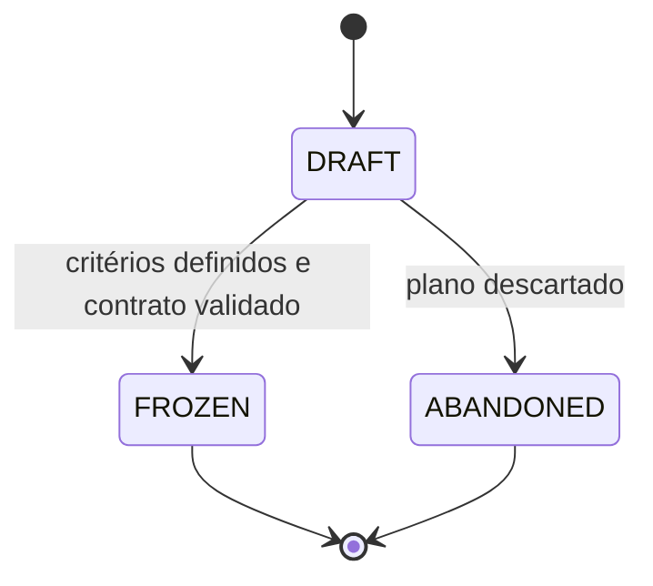
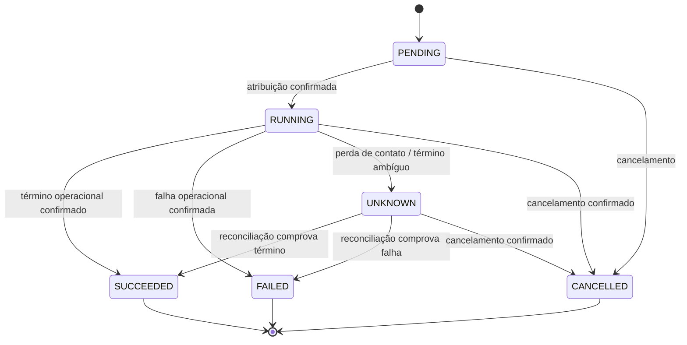
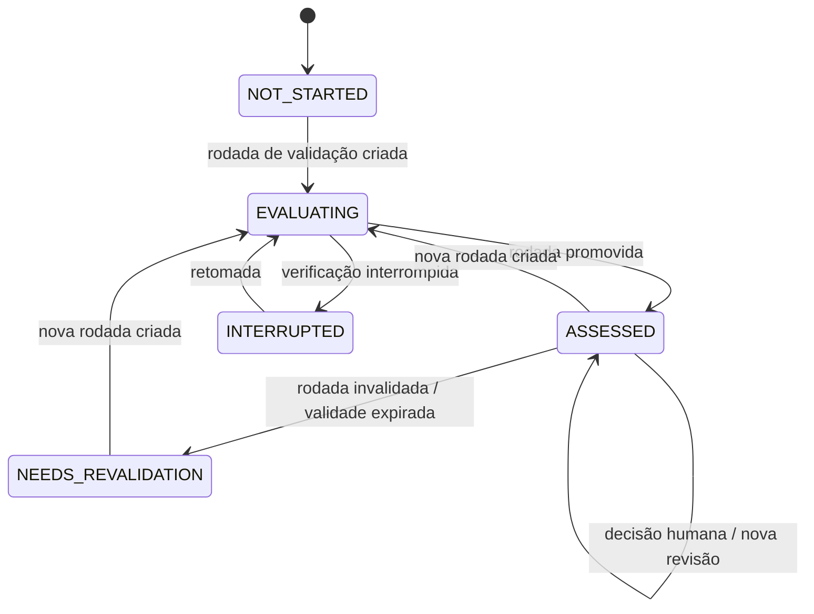
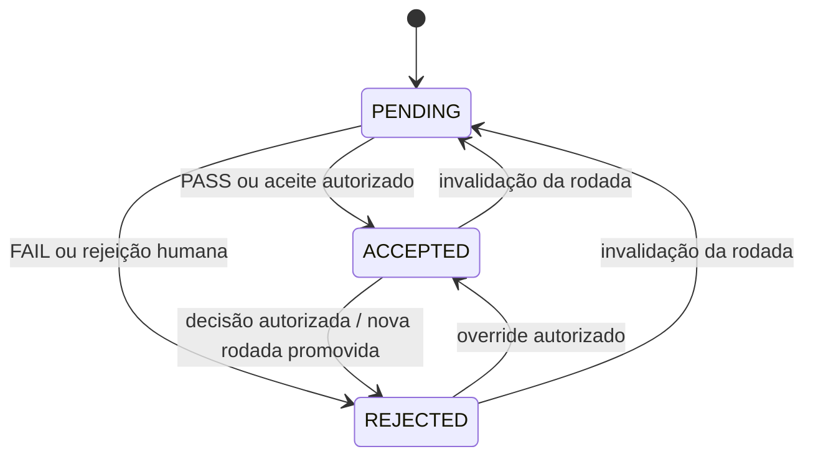

# Harness — Contrato de validação e máquina de estados

**Versão:** 0.2 (especificação conceitual)  
**Data:** 25/11/2026  
**Situação:** especificação conceitual consolidada; implementação e pontos explicitamente adiados ficam reservados para etapas posteriores.

> **Objetivo:** definir um protocolo independente do conteúdo do worker para verificar e aceitar resultados de tarefas. O protocolo distingue execução, entrega, avaliação de critérios e decisão humana. Um resultado só recebe aprovação global quando **todos os critérios obrigatórios** forem aceitos, automaticamente ou por intervenção humana autorizada.

## 1. Escopo e princípios

1. **Agnosticismo do worker.** A harness não precisa conhecer a lógica específica de cada tarefa. O worker deve respeitar um contrato operacional comum; os critérios de sucesso são derivados do pedido do usuário.
2. **Critérios antes do resultado.** A LLM pode propor critérios e validadores com base no prompt/contexto, mas o plano de validação precisa ser congelado **antes** da execução a que se aplica. Resultados não podem retroativamente alterar os critérios para facilitar a aprovação.
3. **Execução ≠ entrega ≠ validação.** Um worker pode terminar com sucesso, entregar um artefato e ainda assim não satisfazer os critérios esperados. Reciprocamente, um efeito externo pode ter ocorrido mesmo que o worker tenha sido interrompido.
4. **Totalidade ou nada na aprovação.** A avaliação pode ser parcial, mas o resultado global só é aprovado com 100% dos critérios obrigatórios aceitos.
5. **Ausência de evidência não é verificação.** Quando não houver validação independente possível, registrar `UNVERIFIED` ou `PARTIALLY_VERIFIED`, conforme os demais critérios; uma aceitação humana pode aprovar o trabalho, mas não transforma ausência de evidência em `VERIFIED`.
6. **Aceitação humana é válida.** Usuário autorizado pode aceitar um critério sem validação automática e pode **sobrescrever uma reprovação automática**. A decisão não elimina nem altera a evidência original.
7. **Proveniência e versão.** Toda aprovação se vincula ao critério, à versão do contrato e à versão exata do resultado. É preciso distinguir verificação independente de aceite manual.
8. **Aceitação e verificação são eixos distintos.** `acceptance_status` informa se o resultado foi aceito segundo o contrato e a política de autoridade. `verification_status` informa o que as verificações independentes sustentam. Uma decisão humana pode alterar a aceitação, mas não reescreve a verificação.
9. **Garantia condicionada à evidência.** `verification_status = VERIFIED` significa que todos os critérios obrigatórios possuem verificação independente aplicável com resultado favorável, dentro do alcance declarado dos validadores; não é uma prova universal de que todo efeito no mundo externo ocorreu.

## 2. Entidades e identificadores

| Entidade | Papel | Identificador sugerido |
|---|---|---|
| `Task` | Pedido lógico do usuário | `task_id` |
| `Attempt` | Tentativa específica vinculada imutavelmente a um contrato congelado | `attempt_id` |
| `ExecutionResult` | Resultado operacional reportado/observado | `attempt_id` + evento |
| `ResultVersion` | Manifesto imutável do resultado produzido por uma tentativa | `result_version_id` |
| `ArtifactVersion` | Artefato imutável referenciado pelo manifesto, com integridade verificável | URI + digest |
| `ValidationContract` | Critérios e validadores associados a uma tarefa | `contract_id`, `contract_version` |
| `Criterion` | Condição atômica de aceitação | `criterion_id` |
| `Evidence` | Saída de um verificador ou outra observação auditável | `evidence_id` |
| `ValidationRun` | Rodada identificada de execução dos validadores sobre uma versão exata do resultado | `validation_run_id` |
| `HumanDecision` | Decisão humana auditável que define, rejeita ou devolve o critério à evidência | `decision_id` |
| `ValidationAssessment` | Identidade estável da avaliação vinculada imutavelmente a contrato e resultado | `assessment_id` |
| `AssessmentRevision` | Revisão imutável e monotônica da projeção de uma avaliação | `assessment_id` + `assessment_revision` |

**Regra de identidade:** `ValidationAssessment` recebe um `assessment_id` opaco e se vincula imutavelmente à tupla (`task_id`, `contract_id`, `contract_version`, `result_version_id`). A persistência deve impor `UNIQUE (task_id, contract_id, contract_version, result_version_id)`, impedindo duas identidades de avaliação para a mesma combinação semântica.

Alterações causadas por novas rodadas, decisões humanas, promoção ou invalidação geram uma nova `assessment_revision` monotônica sob o mesmo `assessment_id`. Cada revisão é imutável; a projeção corrente aponta para a maior revisão efetivamente publicada. Uma nova versão do resultado ou do contrato exige outro `assessment_id`, e aprovações anteriores não migram automaticamente.

`current_validation_run_id` pertence exclusivamente à projeção de `ValidationAssessment`. `Task` armazena apenas `current_assessment_id`; a rodada operacionalmente vigente da tarefa é derivada seguindo a avaliação ativa. Avaliações históricas preservam seus próprios ponteiros sem competir com a avaliação corrente da tarefa.

**Regra de identidade do resultado:** `result_version_id` é opaco e referencia imutavelmente (`task_id`, `attempt_id`, `artifact_manifest`, `manifest_digest`, `created_event_id`). O manifesto enumera todos os artefatos, seus digests e os efeitos externos declarados pela tentativa. A persistência deve impor `UNIQUE (result_version_id)` e `UNIQUE (task_id, attempt_id, manifest_digest)`; a segunda restrição torna idempotente o registro repetido do mesmo manifesto para a mesma tentativa.

O identificador não substitui a verificação de integridade: consumidores devem conferir o `manifest_digest` e, quando necessário, os digests dos artefatos. Um novo manifesto ou qualquer mudança de conteúdo gera outro `result_version_id`. Resultados de tentativas diferentes não são fundidos, mesmo quando possuem manifestos idênticos.

**Registro e seleção:** `RESULT_REGISTERED` apenas torna uma versão conhecida e auditável; não altera o resultado oficial da tarefa. A seleção exige um evento separado `RESULT_SELECTED` no fluxo `task-control:{task_id}`. Esse evento informa `result_version_id`, `previous_result_version_id`, `selection_reason` e a revisão esperada do fluxo de controle.

A seleção só é aceita se o resultado estiver registrado, pertencer à mesma tarefa e conservar vínculos íntegros com sua tentativa, contrato e manifesto. O compare-and-swap deve confirmar simultaneamente a revisão esperada do fluxo e o `previous_result_version_id` observado. Resultado de tentativa atrasada pode ser registrado, mas nunca se torna vigente silenciosamente; sua seleção posterior exige o mesmo evento explícito e as mesmas verificações.

Quando `RESULT_SELECTED` troca a versão vigente, a mesma transação aplica falha fechada:

- define `current_result_version_id` para a nova versão;
- limpa `current_assessment_id`; sem avaliação ativa, a tarefa não possui rodada vigente derivada;
- define `acceptance_status = PENDING`;
- define `verification_status = UNVERIFIED`;
- define `approved = false`.

A avaliação do resultado anterior permanece consultável como histórico, mas deixa imediatamente de representar o estado operacional da tarefa. Nenhuma evidência, decisão humana ou aprovação migra para o novo resultado. A avaliação correspondente à nova tupla poderá ser criada ou selecionada posteriormente, gerando as revisões próprias.

**Ativação da avaliação:** depois de `RESULT_SELECTED`, um evento separado `ASSESSMENT_ACTIVATED` cria ou localiza, pela restrição `UNIQUE`, a avaliação vinculada à tupla (`task_id`, `contract_id`, `contract_version`, `current_result_version_id`) e define `current_assessment_id` no fluxo `task-control:{task_id}`.

A ativação exige compare-and-swap sobre a revisão do fluxo de controle e confirma que o resultado ainda é o vigente. Repetir a mesma solicitação com a mesma chave é idempotente. Se outra versão de resultado tiver sido selecionada, a ativação é rejeitada por conflito. Criar uma avaliação nova mantém `acceptance_status = PENDING`, `verification_status = UNVERIFIED`, `approved = false` e `assessment.current_validation_run_id = null`.

Ao reativar uma avaliação histórica da mesma tupla, a harness restaura sua última revisão somente se:

1. a rodada referenciada pela revisão não foi invalidada;
2. contrato e resultado correspondem exatamente à tupla ativada;
3. nenhuma evidência aplicável ultrapassou sua validade declarada;
4. nenhuma política do contrato ou do tipo de critério exige nova validação.

Se todas as condições forem satisfeitas, a ativação usa `assessment.current_validation_run_id`, as duas projeções e `approved` da última revisão válida. Decisões humanas voltam a ser aplicáveis porque permanecem vinculadas à mesma rodada restaurada. Caso qualquer condição falhe, a avaliação é ativada em falha fechada: `assessment.current_validation_run_id = null`, `acceptance_status = PENDING`, `verification_status = UNVERIFIED` e `approved = false`.

`ASSESSMENT_ACTIVATED` registra `activation_outcome = RESTORED` ou `REVALIDATION_REQUIRED` e, no segundo caso, os motivos. Evidências que possam perder validade devem declarar `valid_until` ou referenciar uma política de frescor do contrato; ausência de limite significa apenas que o protocolo não determinou expiração, não que a afirmação seja universalmente permanente.

## 3. Contrato de validação

### 3.1. Estrutura lógica mínima

```json
{
  "contract_id": "val-123",
  "contract_version": 1,
  "task_id": "task-123",
  "source_prompt_ref": "prompt-123",
  "status": "FROZEN",
  "frozen_event_id": "evt-040",
  "criteria": [
    {
      "criterion_id": "C1",
      "description": "O arquivo de saída existe",
      "required": true,
      "validators": [
        {
          "validator_id": "validator-c1",
          "kind": "FILE_EXISTS",
          "configuration_ref": "validator-config-c1"
        }
      ],
      "evidence_policy": {"kind": "ALL"}
    },
    {
      "criterion_id": "C2",
      "description": "O relatório está claro para o usuário",
      "required": true,
      "validators": [],
      "evidence_policy": {"kind": "ALL"}
    }
  ],
  "acceptance_policy": {
    "required_criteria": "ALL",
    "allow_manual_acceptance": true,
    "allow_manual_override_of_failure": true,
    "preserve_original_evidence": true
  }
}
```

Este JSON é um **exemplo de interface**, não um schema fechado. Identificadores, tipos de validador e campos adicionais serão definidos na implementação.

### 3.2. Regras do plano

- O planejamento pode usar uma LLM para traduzir a solicitação em critérios e propor validadores específicos.
- Cada critério deve ser identificável, rastreável e indicar se é obrigatório. **Somente os obrigatórios** determinam a aprovação global.
- Um critério sem método automático conhecido permanece válido: ele poderá ser avaliado manualmente ou permanecer sem comprovação.
- Antes de iniciar a tentativa, o contrato passa de `DRAFT` para `FROZEN`. Modificações posteriores geram **nova versão**, não edição silenciosa da versão congelada.
- Um contrato sem critérios obrigatórios não autoriza uma aprovação automática por vacuidade matemática. O caso exige revisão/definição de critérios.
- O fato de um validador ter sido gerado pela LLM deve ser registrado. Sua geração não atesta sua correção ou independência.
- Cada critério congela sua lista de `validators` e uma `evidence_policy`. Lista vazia é permitida para critérios exclusivamente humanos, mas nunca produz verificação automática por vacuidade.

### 3.3. Interface mínima do worker

```json
{
  "task_id": "task-123",
  "attempt_id": "attempt-001",
  "contract_id": "val-123",
  "contract_version": 1,
  "contract_frozen_event_id": "evt-040",
  "execution_status": "SUCCEEDED",
  "result_version_id": "result-v1",
  "artifact_manifest": {
    "artifacts": [
      {"uri": "artifacts/task-123/output.md", "digest": "sha256:..."}
    ],
    "declared_external_effects": []
  },
  "manifest_digest": "sha256:...",
  "reported_error": null
}
```

`execution_status = SUCCEEDED` significa sucesso **operacional** da tentativa, não sucesso semântico da tarefa. A harness deve conferir a validade da tentativa e a persistência/identidade dos resultados reportados antes de incorporá-los à avaliação.

### 3.4. Vínculo causal entre contrato e tentativa

Toda `Attempt` nasce vinculada imutavelmente a (`task_id`, `contract_id`, `contract_version`, `contract_frozen_event_id`). A criação ou o início da tentativa só é válido quando:

1. o contrato pertence à mesma tarefa;
2. a versão referenciada está em estado `FROZEN`;
3. `contract_frozen_event_id` identifica o evento que congelou exatamente essa versão;
4. `CONTRACT_FROZEN` possui `global_position` anterior à de `ATTEMPT_STARTED`.

Não existe resolução implícita de “contrato vigente” no início da execução. Uma nova versão do contrato não altera tentativas existentes; uma execução sob a nova versão exige outro `attempt_id`. Tentativas sem contrato prévio não pertencem ao fluxo normal definido por esta especificação.

## 4. Modelo de avaliação por critério

A avaliação precisa preservar **o observado** e **o aceito** separadamente.

### 4.1. Execução do validador e evidência automática

O estado operacional da execução e sua conclusão sobre o critério são eixos separados:

| `validator_run_status` | Semântica | Terminal |
|---|---|---|
| `NOT_STARTED` | Execução prevista, ainda não iniciada. | não |
| `COMPLETED` | Validador executou corretamente e produziu observação. | sim |
| `FAILED` | Execução terminou por erro técnico. | sim |
| `TIMED_OUT` | Execução excedeu seu limite. | sim |
| `CANCELLED` | Execução foi cancelada. | sim |

| `observation` | Semântica |
|---|---|
| `PASS` | O verificador executou e constatou o atendimento ao critério, dentro de seu alcance. |
| `FAIL` | O verificador executou e constatou a violação do critério, dentro de seu alcance. |
| `INCONCLUSIVE` | O verificador executou corretamente, mas não conseguiu confirmar nem refutar o critério. |

`COMPLETED` exige exatamente uma observação `PASS`, `FAIL` ou `INCONCLUSIVE`. Todos os demais estados exigem `observation = null`. Erro técnico, timeout, cancelamento ou execução ainda não iniciada nunca são interpretados como `FAIL` nem como `INCONCLUSIVE`; não produzem observação sobre o conteúdo. Estados operacionais terminais sem observação contribuem como ausência de verificação para a projeção do critério.

### 4.2. Verificação e decisão efetiva sobre o critério

Cada critério possui duas projeções independentes:

| Projeção | Valores | Pergunta respondida |
|---|---|---|
| `criterion_verification_status` | `VERIFIED`, `REFUTED`, `UNVERIFIED` | O que a evidência automática independente aplicável sustenta? |
| `effective_status` | `ACCEPTED`, `REJECTED`, `PENDING` | O critério foi aceito segundo a política de autoridade? |

Mapeamento básico da evidência automática, antes de decisões humanas:

| `observation` | `criterion_verification_status` | `effective_status` padrão |
|---|---|---|
| `PASS` | `VERIFIED` | `ACCEPTED` |
| `FAIL` | `REFUTED` | `REJECTED` |
| `INCONCLUSIVE` ou ausência de observação | `UNVERIFIED` | `PENDING` |

O mapeamento para `effective_status` é a política padrão e pode ser alterado por decisão humana autorizada. O `criterion_verification_status` não é alterado por aceite, rejeição ou override humano.

| `effective_status` | Significado | Origem possível |
|---|---|---|
| `ACCEPTED` | Critério aceito para a versão atual. | `PASS` automático ou aceite/override autorizado. |
| `REJECTED` | Critério não aceito; existe reprovação aplicável ainda não superada. | `FAIL` automático ou rejeição humana. |
| `PENDING` | Sem decisão de aceitação aplicável. | `INCONCLUSIVE`, execução sem observação, evidência ausente. |

**Precedência de aceitação:** uma decisão humana autorizada e aplicável pode substituir o estado **efetivo** de um critério, inclusive após `FAIL`. Ela não altera `criterion_verification_status = REFUTED`. A evidência original deve permanecer intacta no histórico. Decisões concorrentes são resolvidas pela supersessão explícita descrita abaixo.

#### Escopo das decisões humanas

Toda `HumanDecision` deve referenciar explicitamente o `validation_run_id` cujas evidências foram consideradas. A decisão só é aplicável enquanto essa rodada for a vigente para a avaliação.

Quando uma nova rodada é promovida:

- decisões vinculadas à rodada anterior deixam de participar da projeção corrente;
- essas decisões não são revogadas, apagadas nem migradas automaticamente;
- o critério volta a derivar seu `effective_status` das evidências da nova rodada até que exista uma nova decisão humana aplicável;
- a interface deve informar que uma decisão anterior existe, mas está fora de escopo para a rodada vigente.

Mesmo que as evidências da nova rodada sejam idênticas às anteriores, um aceite, uma rejeição ou um override humano exige nova decisão vinculada à nova rodada.

#### Múltiplas decisões humanas na mesma rodada

Para cada par (`criterion_id`, `validation_run_id`), pode existir no máximo uma decisão humana efetiva por vez. A primeira decisão deve declarar que espera não existir decisão efetiva anterior. Toda decisão posterior deve informar `supersedes_decision_id` com o identificador da decisão efetiva que pretende substituir.

O registro usa compare-and-swap:

1. a harness compara `supersedes_decision_id` com a decisão humana efetiva atual;
2. se forem iguais, registra a nova decisão e passa a considerá-la efetiva;
3. se forem diferentes, rejeita a operação por conflito e não altera a projeção;
4. o solicitante deve ler o estado atualizado e decidir novamente de forma explícita.

Decisões substituídas permanecem no histórico. Ordem de chegada ou timestamp, isoladamente, nunca substituem uma decisão humana. A validação de autoridade ocorre antes do compare-and-swap e continua sujeita ao modelo de permissões ainda em aberto.

#### Ações de decisão humana

Uma decisão humana possui uma destas ações:

| `action` | Efeito sobre `effective_status` |
|---|---|
| `SET_ACCEPTED` | Define `ACCEPTED`. |
| `SET_REJECTED` | Define `REJECTED`. |
| `DEFER_TO_EVIDENCE` | Restaura o estado derivado da evidência automática da rodada vigente. |

`DEFER_TO_EVIDENCE` é uma nova decisão auditável e deve substituir a decisão efetiva anterior pelo mesmo mecanismo de compare-and-swap. Ela encerra a intervenção sobre o estado, mas continua sendo a decisão humana corrente para fins de concorrência; uma decisão posterior deve indicar seu `decision_id` em `supersedes_decision_id`.

“Override” não é uma ação distinta. É uma classificação derivada quando a ação humana diverge do estado produzido pela evidência:

- `SET_ACCEPTED` sobre estado automático `REJECTED` é `ACCEPT_OVERRIDE`;
- `SET_ACCEPTED` sobre estado automático `PENDING` é `MANUAL_ACCEPTANCE`;
- `SET_REJECTED` sobre estado automático `ACCEPTED` é `REJECT_OVERRIDE`;
- `SET_REJECTED` sobre estado automático `PENDING` é `MANUAL_REJECTION`;
- decisão que concorda com a evidência é `HUMAN_CONFIRMATION`;
- `DEFER_TO_EVIDENCE` produz `NO_ACTIVE_INTERVENTION`.

A classificação derivada deve ser exposta como `decision_effect`, sem alterar a ação original nem a evidência.

### 4.3. Rodadas de validação e evidências conflitantes

Evidências automáticas são agrupadas em rodadas identificadas por `validation_run_id`. Cada rodada se vincula a uma única tupla (`task_id`, `contract_id`, `contract_version`, `result_version_id`) e registra o conjunto de validadores que deveria executar.

Ao criar uma rodada, a avaliação aloca `run_generation = last_run_generation + 1` por compare-and-swap e registra `VALIDATION_RUN_CREATED` no fluxo de controle. A geração é imutável e única dentro da avaliação; a persistência impõe `UNIQUE (assessment_id, run_generation)`. Depois da criação, a execução da rodada ocorre em `validation-run:{validation_run_id}`.

- Somente uma rodada marcada como vigente participa da projeção atual. Rodadas anteriores permanecem imutáveis e auditáveis, mas não são combinadas com a vigente.
- Uma nova rodada não apaga nem invalida automaticamente as anteriores; apenas cria uma nova candidata à projeção corrente.
- A projeção por critério é calculada pela `evidence_policy` congelada; resultados de validadores não previstos são ignorados e registrados como anomalia.
- Lista vazia de validadores sempre produz `criterion_verification_status = UNVERIFIED`.
- `INCONCLUSIVE` e estados operacionais sem observação não contam como `PASS` nem `FAIL`.
- Toda presença simultânea de `PASS` e `FAIL` é registrada como divergência, mesmo quando a política consegue produzir `VERIFIED` ou `REFUTED`.
- A seleção e substituição da rodada vigente devem ser eventos auditáveis.

#### Políticas de evidência por critério

`ALL` é a política padrão:

- `REFUTED` se ao menos um validador previsto produzir `FAIL`;
- `VERIFIED` somente se todos os validadores previstos produzirem `PASS`;
- `UNVERIFIED` nos demais casos.

`ANY` representa validadores alternativos:

- `VERIFIED` se ao menos um validador previsto produzir `PASS`;
- `REFUTED` se houver ao menos uma observação conclusiva e todas as observações conclusivas forem `FAIL`;
- `UNVERIFIED` se não houver observação conclusiva.

`QUORUM` exige `required_passes` e `blocking_failures`, inteiros positivos compatíveis com a quantidade de validadores previstos:

- `VERIFIED` se `pass_count >= required_passes` e `fail_count < blocking_failures`;
- `REFUTED` se `fail_count >= blocking_failures` e `pass_count < required_passes`;
- `UNVERIFIED` se ambos os limiares forem alcançados ou se nenhum for alcançado.

A explicação da projeção deve informar a política, os validadores previstos, as observações contabilizadas, os estados operacionais sem observação e eventuais divergências.

#### Promoção da rodada vigente

Uma rodada concluída é promovida automaticamente quando todas as condições abaixo forem satisfeitas:

1. está vinculada à mesma tarefa, contrato e versão de resultado da avaliação;
2. todos os validadores previstos na rodada alcançaram um estado terminal;
3. a rodada não foi cancelada nem estruturalmente invalidada;
4. `run_generation` é maior que a geração da rodada vigente, ou não existe rodada vigente;
5. suas evidências e referências passaram pelas verificações estruturais do protocolo.

A promoção gera um evento `VALIDATION_RUN_SELECTED` e atualiza `assessment.current_validation_run_id`. A atualização deve usar compare-and-swap sobre a rodada anteriormente vigente nessa avaliação; se a referência tiver mudado, a promoção falha e precisa ser reavaliada.

Uma rodada que conclui atrasada não pode substituir outra de geração maior já promovida. Sua conclusão e suas evidências permanecem auditáveis, mas a tentativa de promoção é rejeitada como regressão de geração. A ordem de conclusão e `global_position`, isoladamente, não determinam qual rodada é mais nova.

Uma rodada incompleta nunca é promovida automaticamente. Ela só pode se tornar vigente por promoção manual explícita e autorizada, com motivo registrado e indicação visível de incompletude. Uma rodada completa pode conter resultados `INCONCLUSIVE`; completude significa que todos os validadores previstos terminaram, não que todos produziram conclusão sobre o critério.

#### Selamento, correção e invalidação

Uma rodada torna-se selada quando é promovida. Depois disso, seu conjunto de validadores, suas evidências e seus resultados não podem ser editados, substituídos nem complementados.

Quando for descoberto erro em uma rodada selada:

1. registrar um evento de invalidação com motivo e autoria;
2. preservar integralmente a rodada e as projeções históricas que ela produziu;
3. criar uma nova `ValidationRun`, com novo `validation_run_id`, para produzir as evidências corrigidas;
4. submeter a nova rodada às mesmas regras de completude, elegibilidade e promoção.

Resultados de validadores não afetados podem ser reutilizados somente como novas evidências explicitamente registradas na nova rodada, com referência de proveniência à evidência original e após confirmação de que continuam aplicáveis. Não se copiam evidências silenciosamente.

Decisões humanas vinculadas à rodada invalidada não migram para a nova rodada.

Se a rodada invalidada for a vigente, a harness aplica falha fechada na mesma transação que registra a invalidação:

- limpa `assessment.current_validation_run_id` por compare-and-swap contra a rodada invalidada;
- deixa de aplicar imediatamente todas as suas evidências e decisões humanas;
- define `verification_status = UNVERIFIED`;
- define `acceptance_status = PENDING`;
- define `approved = false`;
- publica uma nova revisão da avaliação indicando a invalidação como causa.

Esses valores permanecem até que outra rodada elegível seja promovida. A projeção histórica produzida pela rodada invalidada continua consultável, mas nunca é retornada como estado operacional corrente nem como aprovação vigente.

### 4.4. Exemplo de override auditável

```json
{
  "criterion_id": "C2",
  "validation_run_id": "vr-007",
  "contract_version": 1,
  "result_version_id": "result-v1",
  "automated_observation": {
    "validator_run_status": "COMPLETED",
    "observation": "FAIL",
    "evidence_id": "ev-204",
    "validator_id": "validator-c2"
  },
  "human_decision": {
    "decision_id": "hd-305",
    "validation_run_id": "vr-007",
    "supersedes_decision_id": null,
    "action": "SET_ACCEPTED",
    "actor_id": "user-001",
    "reason": "A exceção identificada foi revisada e aceita",
    "decided_at": "2026-11-25T22:00:00-03:00"
  },
  "effective_status": "ACCEPTED",
  "acceptance_source": "HUMAN_DECISION",
  "decision_effect": "ACCEPT_OVERRIDE",
  "criterion_verification_status": "REFUTED"
}
```

Nesse exemplo, o critério está simultaneamente `ACCEPTED` e `REFUTED`: o verificador independente indicou `FAIL`, mas a pessoa autorizada aceitou a exceção. O histórico e toda apresentação consolidada devem continuar exibindo a discordância.

## 5. Agregação global em dois eixos

Considere somente os critérios com `required = true` e `N > 0`.

### 5.1. Aceitação: totalidade ou nada

Para os estados efetivos, sejam:

- `A`: número de critérios `ACCEPTED`;
- `R`: número de critérios `REJECTED`;
- `P`: número de critérios `PENDING`;
- `N = A + R + P`: total de critérios obrigatórios (com `N > 0`).

A projeção global de aceitação é determinada **nesta ordem de precedência**:

| Condição | `acceptance_status` | `approved` |
|---|---|---|
| `R > 0` | `REJECTED` | `false` |
| `R = 0` e `A = N` | `ACCEPTED` | `true` |
| `R = 0` e `A < N` | `PENDING` | `false` |

Assim, `8 ACCEPTED + 2 PENDING` resulta em aceitação global `PENDING`. `9 ACCEPTED + 1 REJECTED` resulta em aceitação `REJECTED`; um override autorizado pode tornar o décimo critério `ACCEPTED` e a aceitação global `ACCEPTED`.

### 5.2. Verificação independente

Para `criterion_verification_status`, sejam:

- `V`: número de critérios `VERIFIED`;
- `F`: número de critérios `REFUTED`;
- `I`: número de critérios `UNVERIFIED`;
- `N = V + F + I`.

| Condição | `verification_status` |
|---|---|
| `F > 0` | `REFUTED` |
| `F = 0` e `V = N` | `VERIFIED` |
| `F = 0`, `0 < V < N` | `PARTIALLY_VERIFIED` |
| `F = 0` e `V = 0` | `UNVERIFIED` |

Aceitação humana não altera essa projeção. Portanto, um resultado pode ser `acceptance_status = ACCEPTED` e `verification_status = REFUTED` ou `UNVERIFIED`.

### 5.3. Base causal da aprovação e revisão humana

`approval_basis` responde se a aprovação vigente **depende** de decisões humanas:

| Condição | `approval_basis` |
|---|---|
| `approved = false` | `NONE` |
| Todos os critérios seriam `ACCEPTED` sem decisões humanas | `AUTOMATED_ONLY` |
| Alguns, mas não todos, dependem de `SET_ACCEPTED` | `MIXED` |
| Todos dependem de `SET_ACCEPTED` | `HUMAN_ONLY` |

Uma confirmação humana de estado automático `ACCEPTED` não torna a aprovação dependente da pessoa. `DEFER_TO_EVIDENCE` também não constitui base humana. Em contrapartida, `SET_ACCEPTED` sobre estado automático `PENDING` ou `REJECTED` torna aquele critério humanamente dependente enquanto a decisão for aplicável.

Participação humana é informada separadamente por `human_review_status`, considerando decisões aplicáveis à rodada vigente, inclusive confirmações e `DEFER_TO_EVIDENCE`:

| Critérios obrigatórios com decisão humana corrente | `human_review_status` |
|---|---|
| Nenhum | `NONE` |
| Alguns, mas não todos | `PARTIAL` |
| Todos | `COMPLETE` |

Apresentar também:

- contagens de aceitação `accepted`, `rejected`, `pending`;
- contagens de verificação `verified`, `refuted`, `verification_unverified`;
- contagem de critérios com revisão humana;
- lista de divergências/overrides.

**Importante:** `approved = true` se, e somente se, `acceptance_status = ACCEPTED`. `verification_status` nunca deve ser usado isoladamente como sinônimo de aprovação. Esse é o sentido de “totalidade ou nada”; `PENDING` não representa aprovação parcial do trabalho.

## 6. Máquinas de estados

As máquinas abaixo são **independentes**. Não se deve deduzir automaticamente o resultado semântico com base no estado do processo.

### 6.1. Contrato de validação



Uma nova versão nasce como outro `DRAFT`. `FROZEN` é terminal: a versão permanece congelada para sempre e nunca muda para `SUPERSEDED`.

Quando outra versão passa a substituí-la para usos futuros, a harness registra uma relação externa e auditável por `CONTRACT_SUPERSEDED`, contendo a versão anterior, a sucessora e o motivo. Essa relação alimenta uma projeção de disponibilidade, mas não altera o estado nem o conteúdo de nenhuma das versões. Tentativas já vinculadas à versão anterior continuam referenciando-a validamente.

### 6.2. Tentativa de execução do worker (operacional)



- `UNKNOWN` é deliberadamente diferente de `FAILED`: o efeito pode ter acontecido antes da perda de contato.
- Uma nova tentativa recebe **novo** `attempt_id`; não se recicla uma tentativa terminal como se fosse a mesma execução.
- Uma tentativa obsoleta não pode publicar como resultado vigente sem passar pelo controle de identidade/concorrência.
- A política de reconciliação, retentativas e tratamento de efeitos externos permanece em aberto.

### 6.3. Ciclo da avaliação (processo)

`acceptance_status` e `verification_status` são **projeções**, enquanto o processo que coleta evidências possui estado próprio:



- `ASSESSED` não significa aprovado: a aceitação pode ser `ACCEPTED`, `REJECTED` ou `PENDING`, independentemente da projeção de verificação.
- Uma decisão humana posterior gera **nova revisão da avaliação** vinculada ao mesmo resultado e ao mesmo contrato, não altera o histórico.
- Ao surgir um resultado `result-v2`, cria-se uma **nova avaliação**. A anterior continua auditável e não muda de estado apenas por deixar de ser a avaliação ativa da tarefa.

### 6.4. Decisão sobre um critério

Em vez de mutar diretamente um status e perder informação, registrar eventos e **derivar** o status efetivo:



As transições representam alterações na **projeção corrente** após eventos auditáveis; não significam apagar evidências nem reescrever decisões passadas. Concorrência usa gerações de rodada, supersessão explícita de decisões e compare-and-swap no fluxo de controle.

## 7. Eventos mínimos de auditoria

Toda transição relevante deveria gerar um evento persistido antes de ser exposta como decisão consolidada. Tipos ilustrativos:

### 7.1. Envelope comum

Todo evento possui o seguinte núcleo obrigatório:

```json
{
  "event_id": "evt-123",
  "event_type": "VALIDATOR_FINISHED",
  "schema_version": 1,
  "global_position": 123,
  "stream_id": "task-control:task-123",
  "stream_revision": 17,
  "recorded_at": "2026-11-25T22:00:00-03:00",
  "producer": {"type": "SERVICE", "id": "validator-runner"},
  "idempotency_key": "validator-run-007-c1",
  "payload": {}
}
```

- `event_id` identifica imutavelmente o evento.
- `event_type` seleciona o schema do `payload`.
- `schema_version` versiona conjuntamente o envelope e o payload daquele tipo.
- `global_position` define a ordem total autoritativa para auditoria, precedência e replay global.
- `stream_id` identifica o fluxo de concorrência ao qual o evento pertence.
- `stream_revision` é monotônica dentro do fluxo e serve para compare-and-swap.
- `recorded_at` é atribuído pela persistência autoritativa, não pelo produtor.
- `producer` identifica o componente que submeteu o evento.
- `idempotency_key` torna repetição do mesmo comando segura; sua unicidade é avaliada no escopo do produtor.
- `payload` contém os dados específicos e imutáveis do evento.

Campos contextuais são obrigatórios quando semanticamente aplicáveis:

| Campo | Quando é obrigatório |
|---|---|
| `task_id` | Evento pertence a uma tarefa ou a qualquer entidade subordinada a ela. |
| `actor` | A ação representa decisão ou comando de pessoa/identidade autorizada. |
| `occurred_at` | O evento registra fato observado fora da persistência autoritativa. |
| `correlation_id` | O evento participa de uma operação composta ou fluxo distribuído. |
| `causation_id` | O evento foi produzido em consequência direta de outro evento. |

`occurred_at` nunca define precedência; serve apenas como dado de domínio. Ausência de campo contextual obrigatório torna o evento estruturalmente inválido. Cada `event_type` deve declarar em seu schema quais campos contextuais exige.

### 7.2. Tipos mínimos

| Evento | Dados mínimos |
|---|---|
| `CONTRACT_FROZEN` | Contrato, versão, critérios, origem |
| `CONTRACT_SUPERSEDED` | Versão anterior, versão sucessora congelada, motivo |
| `ATTEMPT_STARTED` | Tarefa, tentativa, contrato congelado, evento de congelamento, worker, token de execução |
| `ATTEMPT_FINISHED` | Tentativa, estado observado, timestamp |
| `RESULT_REGISTERED` | Versão, localização e digest do resultado |
| `RESULT_SELECTED` | Resultado vigente, resultado anterior, motivo da seleção |
| `ASSESSMENT_ACTIVATED` | Avaliação vigente, tupla semântica, avaliação anterior, resultado da ativação, motivos de revalidação |
| `VALIDATOR_FINISHED` | Critério, versão, estado operacional, observação opcional, evidência, eventual erro |
| `VALIDATION_RUN_CREATED` | Avaliação, rodada, geração, validadores previstos |
| `VALIDATION_RUN_SELECTED` | Rodada vigente, versão do resultado, rodada anterior, motivo |
| `VALIDATION_RUN_INVALIDATED` | Rodada, motivo, ator, evidências afetadas |
| `HUMAN_DECISION_RECORDED` | Critério, decisão, ator, motivo, rodada de validação, versão do resultado |
| `ASSESSMENT_UPDATED` | Avaliação, revisão monotônica, tupla semântica, contagens, estados agregados, base de aceite |
| `ATTEMPT_RECONCILED` | Tentativa antes `UNKNOWN`, evidência da reconciliação |

**Invariante:** eventos de observação e decisões humanas são append-only (acréscimos, nunca substituição silenciosa). A projeção atual pode mudar; o histórico não.

A persistência deve impor `UNIQUE (event_id)` e `UNIQUE (producer, idempotency_key)`. Reutilizar a mesma chave com payload diferente é conflito, não repetição idempotente.

Também deve impor `UNIQUE (global_position)` e `UNIQUE (stream_id, stream_revision)`. Ao anexar um evento, o produtor informa a revisão esperada do fluxo; se ela não corresponder à revisão corrente, a operação falha por conflito. A posição global é atribuída somente após esse teste e nunca é usada, isoladamente, para autorizar uma atualização concorrente.

### 7.3. Fluxos operacionais e fluxo de controle

Cada tarefa possui um fluxo serializado de controle:

```text
task-control:{task_id}
```

Eventos que alteram o estado oficial da tarefa pertencem a esse fluxo, incluindo congelamento ou substituição de contrato, promoção ou invalidação de rodada, seleção de resultado vigente, decisões humanas efetivas e publicação de revisões da avaliação. O compare-and-swap sobre `stream_revision` desse fluxo serializa essas transições.

Eventos de alto volume ou execução concorrente usam fluxos próprios:

```text
attempt:{attempt_id}
validation-run:{validation_run_id}
```

Início, término e reconciliação operacional pertencem ao fluxo da tentativa. Execuções de validadores e conclusão da rodada pertencem ao fluxo da rodada. Esses eventos podem avançar em paralelo sem disputar a revisão do fluxo de controle.

Um evento operacional não altera sozinho o estado oficial da tarefa. Por exemplo, concluir uma rodada no fluxo `validation-run` apenas a torna candidata; sua promoção exige `VALIDATION_RUN_SELECTED` no fluxo `task-control`, validando as referências e usando a revisão esperada desse fluxo. Referências entre fluxos usam `event_id` e devem apontar para eventos já persistidos com `global_position` anterior.

## 8. Invariantes obrigatórios

**INV-01 — Contrato imutável:** nenhum critério é alterado na versão `FROZEN`.

**INV-01A — Contrato anterior à tentativa:** toda tentativa referencia imutavelmente um contrato congelado, cujo evento `CONTRACT_FROZEN` possui `global_position` anterior à de `ATTEMPT_STARTED`.

**INV-02 — Mesma versão:** nenhuma evidência ou aprovação pode ser usada sem correspondência com `contract_version` e `result_version_id`.

**INV-02A — Identidade única da avaliação:** cada tupla (`task_id`, `contract_id`, `contract_version`, `result_version_id`) corresponde a exatamente um `assessment_id`; suas revisões são imutáveis e monotônicas.

**INV-02B — Resultado imutável e proveniente:** todo `result_version_id` referencia um único manifesto imutável, seu digest e a tentativa que o produziu; alteração do manifesto exige nova versão de resultado.

**INV-02C — Seleção explícita do resultado:** registrar um resultado nunca o torna vigente; somente `RESULT_SELECTED`, serializado no fluxo de controle e protegido por compare-and-swap, altera o resultado oficial da tarefa.

**INV-02D — Falha fechada na troca de resultado:** selecionar nova versão de resultado limpa a avaliação ativa da tarefa — e, por derivação, sua rodada vigente — e define aprovação falsa até que a nova versão seja avaliada.

**INV-02E — Ativação explícita da avaliação:** somente `ASSESSMENT_ACTIVATED`, serializado no fluxo de controle, pode preencher `current_assessment_id`, e sua tupla deve corresponder ao resultado vigente.

**INV-02F — Rodada pertencente à avaliação:** `current_validation_run_id` existe somente em `ValidationAssessment`; a tarefa deriva sua rodada vigente por `current_assessment_id`.

**INV-03 — Não inferência de sucesso:** `execution_status = SUCCEEDED` não implica `acceptance_status = ACCEPTED` nem `verification_status = VERIFIED`.

**INV-04 — Aprovação integral:** `approved = true` exige que todos os critérios obrigatórios estejam efetivamente `ACCEPTED`.

**INV-05 — Falta de conclusão:** `INCONCLUSIVE` ou execução sem observação não contam como aceite automático.

**INV-05A — Eixos do validador:** somente `validator_run_status = COMPLETED` possui observação; falha, timeout, cancelamento ou não início nunca implicam `FAIL` do critério.

**INV-06 — Override rastreável:** uma reprovação sobreposta por decisão humana continua disponível no histórico e na explicação da aprovação.

**INV-07 — Autoridade:** decisões manuais só são efetivas após validação de autorização; detalhes de papéis/permissões ficam em aberto.

**INV-08 — Isolamento das dimensões:** falha do processo, falha de publicação e refutação de critério não são estados equivalentes.

**INV-09 — Tentativa inequívoca:** resultados de tentativas obsoletas não se tornam vigentes silenciosamente.

**INV-10 — Sem critérios vazios:** a harness não aprova automaticamente uma tarefa sem critérios obrigatórios válidos.

**INV-11 — Eixos independentes:** decisão humana pode alterar `effective_status` e `acceptance_status`, mas nunca altera a observação automática nem `criterion_verification_status`/`verification_status`.

**INV-12 — Decisão vinculada à rodada:** uma decisão humana só participa da projeção quando seu `validation_run_id` corresponde à rodada vigente.

**INV-13 — Supersessão explícita:** uma nova decisão humana só se torna efetiva se substituir, por compare-and-swap, a decisão efetiva que declarou ter observado.

**INV-14 — Rodada selada:** evidências de uma rodada promovida nunca são alteradas; correções exigem invalidação auditável e nova rodada.

**INV-15 — Falha fechada após invalidação:** uma rodada vigente invalidada deixa de sustentar imediatamente qualquer verificação, aceitação ou aprovação corrente.

**INV-16 — Geração monotônica da rodada:** cada rodada possui geração única e imutável dentro da avaliação; promoção automática nunca substitui uma rodada por outra de geração menor ou igual.

## 9. Exemplos de aceitação

| Cenário | Projeção esperada |
|---|---|
| 10 critérios `PASS` | Aceitação `ACCEPTED`; verificação `VERIFIED`; aprovação `true`; base `AUTOMATED_ONLY` |
| 8 validadores `COMPLETED/PASS`, 2 `TIMED_OUT` | Aceitação `PENDING`; verificação `PARTIALLY_VERIFIED`; aprovação `false` |
| 10 validadores `TIMED_OUT` | Aceitação `PENDING`; verificação `UNVERIFIED`; aprovação `false` |
| 9 critérios `PASS`, 1 `FAIL` | Aceitação `REJECTED`; verificação `REFUTED`; aprovação `false` |
| 9 `PASS`, 1 `FAIL` + override humano autorizado desse critério | Aceitação `ACCEPTED`; verificação `REFUTED`; aprovação `true`; base `MIXED`; divergência preservada |
| 9 `PASS`, 1 sem validador + aceite humano autorizado | Aceitação `ACCEPTED`; verificação `PARTIALLY_VERIFIED`; aprovação `true`; base `MIXED` |
| 10 critérios aceitos só pelo usuário | Aceitação `ACCEPTED`; verificação `UNVERIFIED`; aprovação `true`; base `HUMAN_ONLY` |
| Validador sofre timeout sem avaliar o critério | Verificação `UNVERIFIED`; aceitação `PENDING`; nunca `REJECTED` apenas pelo timeout |
| Worker conclui, mas não há critérios comprovados | Execução `SUCCEEDED`; verificação `UNVERIFIED`; aceitação `PENDING` |
| Worker morre após produzir artefato, antes de confirmar | Execução pode estar `UNKNOWN`; reconciliar resultado antes de retentar |
| Arquivo aprovado na versão v1 é modificado para v2 | Avaliação v1 preservada; v2 não herda aprovação automaticamente |

## 10. Pontos em aberto — **não definidos nesta versão**

Estes itens são **deliberadamente adiados**. Não devem ser tratados como decisões arquiteturais já tomadas:

1. **Qualidade e independência dos validadores:** como verificar que um teste gerado por LLM é correto, suficientemente independente do worker e não replica o mesmo erro?
2. **Completude dos critérios de sucesso:** como detectar omissões no plano gerado a partir do prompt e qual processo aceita ou rejeita um contrato antes de congelá-lo?
3. **Efeitos colaterais e operações externas:** como identificar, confirmar e eventualmente compensar ações não idempotentes (envio de mensagens, transferências, alterações em APIs e bancos)? Quais garantias são realmente possíveis?
4. **Modelo de autoridade:** quais usuários podem aprovar critérios, sobrescrever reprovações ou invalidar evidências, e para quais tipos de tarefa?
5. **Recuperação pós-reprovação:** em que condições a harness deve corrigir automaticamente, criar nova tentativa, pedir confirmação ou encerrar a tarefa?
6. **Autoridade para operações excepcionais:** quais papéis podem promover rodadas incompletas, invalidar rodadas ou emitir decisões humanas? Conflitos de evidência são reduzidos pela `evidence_policy` e sempre exibidos; decisões humanas concorrentes usam supersessão explícita com compare-and-swap; correções exigem nova rodada; invalidação da rodada vigente aplica falha fechada.
7. **Critérios opcionais e condicionais:** como representar critérios dependentes de contexto e qual impacto de verificações opcionais no relatório final?
8. **Mecanismo de execução dos validadores:** como isolar com segurança código de teste gerado por LLM, limitar acesso a ferramentas e controlar consumo de recursos?
9. **Timeout, cancelamento e revisão do contrato:** quais prazos, limites de retentativa e permissões para reabrir/reespecificar o trabalho?
10. **Implementação física da persistência:** esquema SQLite, limites transacionais, alocação de `global_position`, fencing tokens e recuperação após crash. A semântica de ordem, idempotência e compare-and-swap já está definida neste contrato.
11. **Evidências externas e procedência:** quais fontes são consideradas autoritativas e como conservar provas verificáveis de efeitos fora da harness?
12. **Apresentação ao usuário:** como apresentar conjuntamente `acceptance_status` e `verification_status`, com destaque proporcional para divergências e overrides?

## 11. Limites assumidos nesta versão

- O contrato define **como registrar, avaliar e aceitar** resultados; não promete comprovar automaticamente qualquer objetivo arbitrário.
- A harness pode criar verificações específicas por tarefa sem embutir regras de negócio no orquestrador.
- O usuário tem autoridade final para aceitar critérios, inclusive contestando uma reprovação automática, desde que o ato seja explícito, autorizado e auditável.
- Nenhum mecanismo deve transformar um `UNVERIFIED` em sucesso apenas porque o worker declarou ter concluído a tarefa.
- Esta versão **não** especifica APIs definitivas, SQL, implementações de worker, políticas de segurança nem estratégia de recuperação completa.

---

**Resumo de decisão:** a harness executa workers agnósticos ao domínio; gera e congela previamente critérios específicos; registra observações e decisões sem apagar histórico; permite aceite humano e override; mantém aceitação separada de verificação independente; e só declara aprovação quando **todos** os critérios obrigatórios tiverem sido aceitos.
