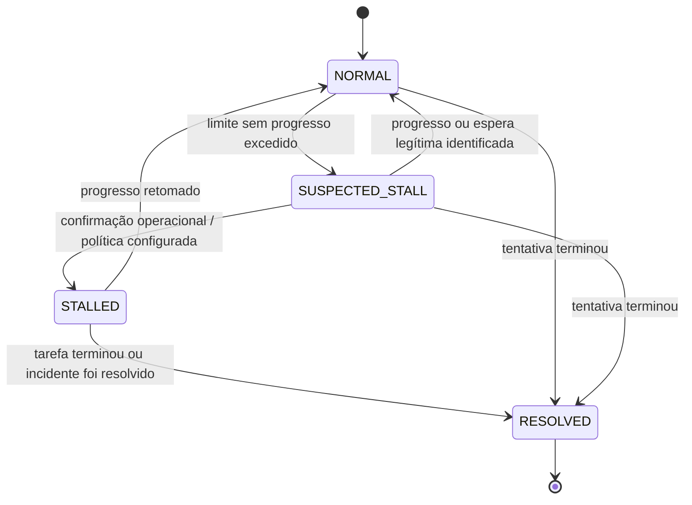
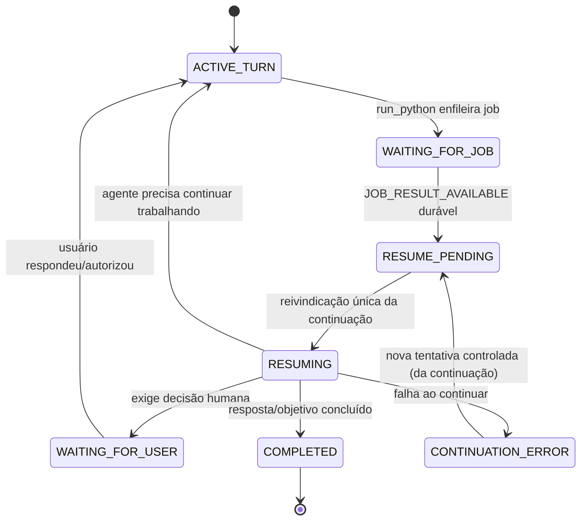
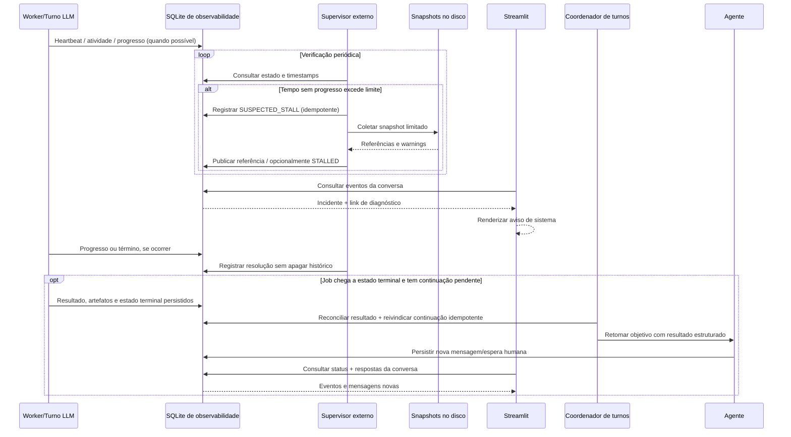

# Harness — Supervisão, diagnósticos e continuidade automática das tarefas

**Versão:** 0.2 — proposta de arquitetura, não implementação
**Data:** 26/11/2026
**Status:** requisitos discutidos e adaptações propostas; decisões pendentes explicitamente marcadas como **pontos em aberto**.

> **Objetivo:** (a) tornar execuções sem progresso observável identificáveis, diagnosticáveis e auditáveis por supervisor independente; (b) apresentar o estado das tarefas **na própria conversa**, sem exigir navegação à aba **Tarefas**; e (c) **retomar automaticamente a conversa/fluxo do agente após o resultado terminal da tarefa ser persistido**, sem o botão **Analisar resultado**. A detecção de `STALLED` continua **sem** reinicialização, retentativa ou alteração do estado da tarefa por conta própria. A retomada conversacional após conclusão não equivale a uma retentativa do worker nem dispensa aprovações humanas.

## 1. Contexto e relação com a arquitetura existente

Esta proposta complementa, sem substituir:

- [`contrato_validacao_maquina_estados_harness.md`](contrato_validacao_maquina_estados_harness.md), que separa **execução**, **entrega** e **validação/aceitação** e mantém `VERIFIED` condicionado à aceitação de todos os critérios obrigatórios;
- [`proposta_tokens_execucao_harness.md`](proposta_tokens_execucao_harness.md), que define tokens por tentativa, *fencing* e lease não renovável;
- o código atualmente visível no repositório [`rafaelimai/qwen_harness_streamlit`](https://github.com/rafaelimai/qwen_harness_streamlit), branch `main`, consultado em 26/11/2026.

### 1.1. Base já presente no projeto (verificada no repositório)

| Arquivo/componente | Comportamento observado | Implicação para a proposta |
|---|---|---|
| `worker.py` | Worker independente da UI, consome um job por vez e usa Docker para executar scripts isolados | Acrescentar telemetria e vínculo explícito entre processo, tentativa e contêiner, **sem** mover a execução para o Streamlit |
| `worker.py:run_job` | Usa `active_token`, verifica obsolescência/cancelamento, coleta `stdout`/`stderr`, aplica timeout e publica artefatos | Preservar o *fencing* e instrumentar os pontos de transição/observação já existentes |
| `jobs.py:JobStore` | Mantém fila em `jobs.sqlite3`, `active_token`, `lease_expires_at` e `attempt_number`; `claim()` é transacional | Correlacionar diagnósticos a `job_id` **e** `attempt_id`/token, sem modificar o significado do lease |
| `jobs.py:worker_state` | Um registro global `id=1` com `heartbeat`, atualizado por `store.heartbeat()` | Isso indica atividade global, **não identifica individualmente** vários workers nem a tarefa ativa |
| `app.py:task_panel` | `@st.fragment(run_every='3s')` consulta tarefas e exibe status, logs, validação e botão **Analisar resultado** | Manter aba para investigação detalhada, mas não como requisito para consultar o estado ou continuar o fluxo |
| `app.py` | Turno do agente é consumido via `graph.stream(...)` no Streamlit | Travamento do **turno LangGraph/LLM** pode ocorrer sem nenhum job Docker ativo; exige observabilidade separada; UI não deve ser o único motor da retomada |
| `agente.py:run_python` / `route_after_tools` / `handoff` | `run_python` enfileira a tarefa; o grafo encerra o turno (`handoff`), e o texto instrui acompanhar a aba e clicar em **Analisar resultado** | Introduzir continuação durável vinculada ao `job_id`, substituindo a dependência do clique/manual prompt |
| `storage.py` / histórico da conversa | Mensagens são preservadas, mas o README indica ausência de checkpoint durável dos nós LangGraph | Persistir intenção de continuação e correlacioná-la ao histórico sem pressupor retomada automática do ponto interno do grafo |
| `validation.py` | Possui armazenamento de eventos e projeções para validação/aceitação | Reutilizar padrões de idempotência/auditoria, mas não confundir incidente operacional com resultado de validação |

**Limite importante do escopo atual:** o `jobs.py` aceita timeouts de scripts de **1 a 600 segundos**, e `worker.py` adiciona uma margem operacional de 10 segundos. Portanto, um alerta após **horas** sem progresso é mais característico de um *turno do agente/LLM*, de uma espera não instrumentada ou de uma anomalia do supervisor do que de uma execução Docker legítima sob o limite atual. O sistema proposto deve cobrir **ambas as superfícies**, com políticas distintas.

**Nota de precisão:** o repositório foi inspecionado, mas o estado dos processos que rodaram no homelab durante a madrugada **não** foi observado diretamente. A proposta não afirma que um travamento específico já tenha sido diagnosticado.

## 2. Decisões e princípios

1. **Supervisor independente.** A coleta e a classificação de incidentes não dependem de o worker ou a LLM conseguirem responder.
2. **Três sinais distintos.** `last_heartbeat_at`, `last_activity_at` e `last_progress_at` têm semânticas diferentes e não podem ser substituídos uns pelos outros.
3. **Progresso comprovável, não aparente.** CPU alta, heartbeats e logs repetitivos podem representar atividade sem avanço em direção ao objetivo.
4. **Suspeita não é falha.** Um longo intervalo sem progresso gera suspeita e diagnóstico, não reprovação automática da execução nem da validação.
5. **Visibilidade na conversa.** O usuário vê o status operacional e de validação das tarefas, além dos incidentes, na própria conversa que as originou; a aba **Tarefas** é complementar, não obrigatória.
5a. **Retomada automática orientada a eventos.** Quando uma tarefa vinculada a um fluxo pendente chega a estado terminal, a harness agenda **uma** continuação conversacional após persistir o resultado. Nenhum clique em **Analisar resultado** é requerido; a continuação não concede permissões de ferramenta nem reexecuta automaticamente o job.
6. **Diagnóstico sem intervenção destrutiva.** Na versão inicial, não matar processos, revogar tokens, encerrar contêineres nem retentar automaticamente em resposta a `STALLED`.
7. **Snapshots limitados e seguros.** Registrar metadados relevantes, caudas de logs e evidências disponíveis; não realizar dump bruto de RAM ou segredos.
8. **Preservar as garantias existentes.** Leases não renováveis, tokens por tentativa, cancelamento e isolamento de workspaces continuam com suas semânticas próprias.
9. **Atenção a concorrência.** Um worker que perdeu seu token pode aparecer no histórico, mas não pode modificar o estado vigente da tarefa; seus diagnósticos históricos devem permanecer identificáveis.
10. **Operação local simples.** Preferir SQLite + arquivos JSON, sem impor Redis ou serviço remoto para o MVP.

## 3. Modelo de observabilidade

### 3.1. Sinais básicos

| Campo | Definição | Origem sugerida | O que **não** demonstra |
|---|---|---|---|
| `last_heartbeat_at` | Última prova de vida do processo **ou componente monitorado**, associada à sua identidade | Heartbeat dedicado do worker/supervisor | Que a tarefa está progredindo |
| `last_activity_at` | Última atividade observável: chamada de ferramenta, mudança de fase, bytes de log, resposta de API ou amostra de trabalho | Eventos instrumentados ou coletor externo | Que houve avanço útil |
| `last_progress_at` | Último marco de progresso com significado **declarado e verificável** para a fase observada | Contador de tokens aumentando, etapa concluída, artefato novo, resposta recebida etc. | Correção semântica do resultado |

**Regra de interpretação:** se um sinal não é instrumentado, registrar `null`/`UNKNOWN`, não presumir que ele foi observado. `last_progress_at = null` não prova imobilidade. Logs ruidosos não devem renovar `last_progress_at` automaticamente.

### 3.2. Identidades e correlação

Cada evento/diagnóstico deve incluir, conforme aplicável:

- `session_id` — conversa;
- `task_id` / `job_id` — trabalho lógico;
- `attempt_id` — tentativa inequívoca, mapeável ao `active_token` já existente;
- `worker_instance_id` — processo/instância de worker, com reinício distinguível;
- `container_id` / `container_name` — contêiner Docker da tentativa;
- `agent_turn_id` — turno da conversa/execução LangGraph, quando o problema estiver fora da fila Docker;
- `incident_id` e `snapshot_id` — incidente e diagnóstico coletado.

**Atenção:** `worker_instance_id` não é `attempt_id`. Um processo worker pode executar várias tentativas em sequência; uma tarefa pode ter várias tentativas e passar por processos diferentes.

### 3.3. Fases de execução observáveis

Fases ilustrativas, opcionais e extensíveis: `CLAIMING`, `CREATING_CONTAINER`, `EXECUTING_SCRIPT`, `COLLECTING_ARTIFACTS`, `PUBLISHING_RESULT`, `WAITING_FOR_LLM`, `LLM_PREFILL`, `LLM_GENERATION`, `TOOL_CALL`, `WAITING_FOR_USER` e `FINALIZING_TURN`.

As fases são **metadados de observabilidade**, não substituem os estados já definidos em `jobs.py` nem os estados de validação do contrato anterior. O monitor deve saber quando uma espera é **intencional**, por exemplo `WAITING_FOR_USER`, para não tratá-la como bloqueio inesperado.

## 4. Saúde operacional: dimensão independente

### 4.1. Máquina de estados proposta



- `SUSPECTED_STALL`: suspeita baseada em sinais e limites; ainda cabe falso positivo.
- `STALLED`: classificação **operacional** por política de monitoramento, não prova de deadlock.
- `RESOLVED`: incidente de saúde encerrado; não quer dizer `SUCCEEDED` nem `VERIFIED`.
- `UNKNOWN_HEALTH`: condição derivada quando a telemetria é insuficiente ou o supervisor perde contato; pode ser tratada como resultado da avaliação de saúde, sem forçar uma transição de sucesso/falha.
- `RECOVERING` fica **reservado para evolução posterior**, se houver recuperação automática formalizada.

**Invariante:** `(execution_status, health_status, validation_status)` são dimensões distintas. Exemplo válido: `(running, STALLED, UNVERIFIED)`.

### 4.2. Detecção sugerida

1. Obter a identidade e a fase corrente da tentativa ou do turno.
2. Descartar ou classificar separadamente esperas explicitamente intencionais (`WAITING_FOR_USER`, limite de API conhecido etc.).
3. Calcular tempo desde o último progresso **mensurável**; distinguir `sem progresso` de `sem telemetria de progresso`.
4. Se excedido um limite configurado, abrir `SUSPECTED_STALL`, registrar quais condições dispararam e coletar evidências.
5. Aplicar checagens adicionais, se disponíveis: processo vivo, Docker ativo, CPU, crescimento de logs, LLM recebendo requisições ou aumentando contador de tokens.
6. Se a condição persistir segundo a política, classificar `STALLED`, armazenar snapshot e publicar notificação persistente.
7. Quando houver progresso verificável ou término da tentativa/turno, registrar resolução **sem apagar** os eventos anteriores.

**Configuração:** limites diferentes por fase/componente; não assumir que uma simulação científica longa e um turno de geração de texto têm o mesmo perfil temporal.

## 5. Snapshot: o que coletar

O snapshot é uma **fotografia auditável e datada**. Ele deve registrar também falhas e lacunas de coleta; um snapshot parcial continua útil.

| Categoria | Dados desejáveis | Fonte/exemplo | Limites |
|---|---|---|---|
| Identidade | `incident_id`, `session_id`, `job_id`, `attempt_id`, `worker_instance_id`, `agent_turn_id` | Banco/eventos | Nunca depender só do PID, que pode ser reutilizado |
| Estado operacional | Estado da fila, fase, token ativo, lease e cancelamento | `jobs.sqlite3` | Lease expirado **não** implica token `stale` sem nova posse |
| Tempos | Início, heartbeat, atividade, progresso, tempo sem avanço e coleta | Eventos/relógio | UTC para auditoria, monotônico para medições no mesmo processo |
| Processo/host | PID, PPID, estado, CPU, RSS, RAM, swap, pressão de memória, disco | `psutil`, `/proc` | Indisponibilidade não invalida snapshot |
| Docker | Nome/ID, estado, exit code, limites, estatísticas, OOM quando observável | Docker inspect/stats com timeout | Sem `exec` arbitrário no contêiner em incidente |
| LLM | Modelo, requisição/turno ativo, fase, tempo de chamada, contadores de tokens se disponíveis | Instrumentação do cliente; métricas do servidor | `/slots` e métricas dependem do servidor/configuração; não presumir disponibilidade |
| Ferramentas | Nome da ferramenta, horário de início/fim, timeout, resultado estrutural | Eventos de ferramentas | Evitar registrar argumentos sensíveis completos |
| Logs | Cauda com tamanho máximo, contagem de bytes, carimbo de hora | `stdout`/`stderr`, logs de serviço | Sanitizar segredos e limitar volume |
| Artefatos | Lista de caminhos relativos, tamanhos, hashes e últimos horários observados | Workspace da conversa | Não interpretar simples mtime como comprovação semântica |
| Persistência | Versão do esquema, último evento e estado da tentativa | SQLite | Consultas somente leitura e de duração limitada |
| Diagnóstico | Hipóteses, gatilhos disparados, indisponibilidades, qualidade da coleta | Supervisor | Hipóteses não são causas confirmadas |

### 5.1. Exemplo de envelope JSON (ilustrativo)

```json
{
  "schema_version": 1,
  "snapshot_id": "snap_example_001",
  "incident_id": "inc_example_001",
  "captured_at": "2026-11-26T05:32:00Z",
  "scope": "docker_attempt",
  "session_id": "session_example",
  "job_id": "job_example",
  "attempt_id": "token_example",
  "worker_instance_id": "worker_example",
  "execution_status": "running",
  "health_status": "SUSPECTED_STALL",
  "phase": "EXECUTING_SCRIPT",
  "signals": {
    "last_heartbeat_at": "2026-11-26T05:31:50Z",
    "last_activity_at": "2026-11-26T04:10:00Z",
    "last_progress_at": "2026-11-26T04:08:00Z",
    "seconds_without_progress": 5040
  },
  "trigger": {
    "kind": "NO_OBSERVED_PROGRESS",
    "threshold_seconds": 3600,
    "certainty": "SUSPECTED"
  },
  "observations": {
    "process_alive": true,
    "cpu_percent": null,
    "container_state": "running",
    "llm_tokens_generated_delta": null
  },
  "capture_warnings": [
    "Métricas de CPU indisponíveis no momento da coleta"
  ],
  "log_tail_ref": "diagnostics/inc_example_001/worker_stdout_tail.txt",
  "automatic_recovery_started": false
}
```

O objeto acima é um **formato candidato**. O exemplo não representa uma execução real.

### 5.2. Segurança e limites

- **Não** persistir: chaves, tokens de autenticação, variáveis de ambiente completas, dumps de memória, conteúdos integrais de prompts/documentos por padrão.
- Limitar caudas de logs por fluxo e a duração total de cada coleta; aplicar mascaramento de segredos e isolamento por `session_id`.
- Tratar logs e saídas de ferramentas como dados não confiáveis (inclusive eventuais instruções adversariais contidas no texto).
- Não deixar coleta de evidências bloquear a fila, o monitor ou o Streamlit; registrar `capture_error` se uma fonte falhar.
- Persistir metadados antes de tentar coletas mais custosas para não perder o gatilho do incidente.
- Definir política de retenção e teto total de disco antes de habilitar coleta recorrente.

## 6. Adaptações propostas à estrutura do worker

### 6.1. `jobs.py` — persistência e identificação

**Manter:** `jobs.sqlite3`, fila, `claim()` com `BEGIN IMMEDIATE`, `active_token`, `lease_expires_at`, `attempt_number`, `token_is_active()` e `update_attempt()` condicionando a gravação ao token.

**Adicionar sem reinterpretar a fila:**

1. Identidade de instância (`worker_instance_id`) criada a cada início de processo, distinta do PID e do token de tentativa.
2. Registro de heartbeat **por instância**, com `pid`, `started_at`, `last_heartbeat_at`, versão do worker e tentativa atual (quando houver). A linha global atual `worker_state(id=1)` pode ser mantida transitoriamente por compatibilidade, mas não deve ser a fonte exclusiva de verdade para múltiplos workers.
3. Metadados de observabilidade por tentativa: `phase`, `last_activity_at`, `last_progress_at`, tipo/descrição do último progresso, timestamps de transição e identificação de contêiner.
4. Incidentes e snapshots persistidos separadamente do `jobs.status`; não adicionar `stalled` à lista de estados terminais da fila.
5. Operações transacionais/idempotentes para anexar eventos e registrar a referência a um snapshot, sem permitir que tokens obsoletos atualizem **o resultado vigente**.

**Forma candidata de persistência (não schema definitivo):**

```text
jobs.sqlite3
  jobs                    # existente; estado vigente da tarefa
  worker_state            # existente; compatibilidade temporária
  worker_instances        # novo; heartbeat por processo
  execution_observations  # novo; eventos de fase/atividade/progresso
  execution_incidents     # novo; incidentes, status, gatilhos e resolução
  diagnostic_snapshots    # novo; referências de arquivos + integridade
```

Os eventos de diagnóstico de tentativas antigas podem continuar append-only, mesmo após a troca de token. Já mudanças no estado vigente da tarefa permanecem protegidas por *fencing*.

### 6.2. `worker.py` — instrumentação de baixo acoplamento

Preservar `DockerEngine`, o fluxo `create → start → result → export → remove`, os arquivos `attempts/<token>/logs/` e o isolamento dos resultados por token.

**Pontos de instrumentação sugeridos:**

| Ponto atual | Evento/observação adicional |
|---|---|
| `main()` inicia | `WORKER_STARTED` com `worker_instance_id` e PID |
| `JobStore.claim()` retorna tarefa | `ATTEMPT_CLAIMED` e associação entre instância e token |
| Antes/depois de `engine.create()` | `PHASE_CHANGED(CREATING_CONTAINER)` e registro de identificação Docker |
| Após `engine.start()` | `PHASE_CHANGED(EXECUTING_SCRIPT)` |
| Loop que hoje chama `store.heartbeat()` | Heartbeat individual + última atividade observada, **sem renovar progresso artificialmente** |
| Detecta saída do runner ou artefatos | `PROGRESS_RECORDED` com evidência concreta (ex.: runner terminou, arquivo coletado) |
| Antes/depois de `engine.export()` | `PHASE_CHANGED(COLLECTING_ARTIFACTS/PUBLISHING_RESULT)` |
| Encerramento, cancelamento ou token `stale` | Evento de término/abandono com token e motivo |

**Cuidado com operações bloqueantes:** heartbeat executado apenas no loop `run_job()` pode parar durante uma chamada de Docker bloqueada. Para supervisão confiável, o sinal de vida da **instância** precisa ser produzido por um componente capaz de continuar registrando a existência do processo, e o supervisor externo deve verificar essa condição independentemente. Separar *heartbeat* do laço de execução não comprova progresso; apenas melhora a observação de vitalidade.

**Regra de *fencing* preservada:** se um worker `A` perder a posse para `B`, `A` não pode publicar artefatos como resultado vigente, alterar estado terminal de `B` ou resolver o incidente de `B`. Pode, porém, deixar um registro histórico próprio com o token obsoleto, sem comprometer a tarefa corrente.

### 6.3. Módulo novo `supervisor.py` (nome provisório)

Processo independente do Streamlit **e** do worker, iniciado junto com os serviços do homelab. Responsabilidades:

- Consultar com frequência limitada o SQLite e fontes externas (SO, Docker e, opcionalmente, servidor de inferência).
- Avaliar regras de suspeita e incidentes com base nas fases e métricas disponíveis.
- Fazer coleta tolerante a falhas de snapshots, com prazos por fonte e teto total.
- Registrar incidentes e resoluções de maneira idempotente.
- **Nunca** executar comandos arbitrários fornecidos pelo agente ou por logs.
- Continuar em operação se o worker morrer, a UI fechar ou a LLM ficar bloqueada.

**Resiliência do supervisor:** uma exceção na coleta do Docker ou do servidor LLM não deve derrubar o monitor completo. Caso o próprio supervisor reinicie, ele deve recuperar incidentes abertos do banco e evitar alertas duplicados.

### 6.4. `app.py` / Streamlit — status de tarefas e incidentes na conversa

A conversa passa a ser a **interface primária** para acompanhar o trabalho. O usuário não precisa abrir a aba **Tarefas** para saber se um job foi enfileirado, iniciado, concluído, falhou, aguardou aprovação ou entrou em suspeita de `STALLED`. O `task_panel()` continua existindo para consultar detalhes, logs, validação, artefatos e ações opcionais.

**Requisitos de interação:**

1. Ao enfileirar `run_python`, exibir na conversa um **cartão/evento operacional** com identificador curto, nome do script, estado `QUEUED`, vínculo com o pedido e indicação de que a continuação será automática.
2. Atualizar esse cartão, ou sua pequena linha do tempo, a partir de eventos persistidos: `STARTING`, `RUNNING`, estados terminais, `SUSPECTED_STALL`/`STALLED`, validação e espera por ação humana. Não criar uma nova mensagem para cada heartbeat/poll.
3. **Distinguir** estado operacional do job, saúde operacional e resultado da validação/aceitação. `succeeded` não equivale a `VERIFIED`; `STALLED` não equivale a `failed`.
4. A mensagem do incidente contém horário, tempo sem progresso, diagnóstico disponível e status da intervenção. Uma notificação do sistema **não** se torna mensagem do usuário nem resposta da LLM.
5. Os cartões permanecem associados à conversa por `session_id`, `job_id` e `agent_turn_id` e são reconstituídos depois de recarregar a página; `st.session_state` é somente cache/estado de apresentação.
6. Enquanto uma tarefa está pendente, a conversa mostra **"Aguardando conclusão da tarefa para continuar"**; ao detectar o evento terminal, mostra **"Retomando análise do resultado"**, sem pedir clique.
7. Se o fluxo exigir aprovação de segurança ou resposta do usuário, mostrar `WAITING_FOR_USER` com controles existentes. **Não** gerar autorização nem aprovação implícita.
8. `Analisar diagnóstico` continua opcional e explícito: o usuário pode permitir que o resumo sanitizado do snapshot chegue ao agente. O alerta por si só não injeta logs arbitrários no prompt.
9. Se a UI estiver ocupada em `graph.stream()`, o backend deve persistir os eventos. A atualização visual em tempo real exige que a execução de turnos não monopolize o mesmo ciclo de renderização da interface.

**Exemplo ilustrativo dentro do chat:**

> **Execução `job_…a17` — `work/orbita_gnss.py`**
> `RUNNING` · tentativa 2 · último progresso há 8 min
> A harness acompanhará e retomará esta conversa quando houver resultado.
>
> ⚠️ **Suspeita de ausência de progresso** após o limite configurado. Snapshot `snap_…` disponível. A tarefa não foi cancelada.
>
> ✅ **Execução concluída** · resultado persistido · validação: `PARTIALLY_VERIFIED`.
> **Continuação em preparação** — nenhuma ação manual é necessária para analisar o resultado; critérios de aceite que exijam usuário continuarão pendentes.

IDs, horários e estados são fictícios. A aba **Tarefas** mostra o mesmo estado persistido e detalhes adicionais, mas não controla a continuidade do chat.

### 6.5. Monitorar também a execução da LLM/turno LangGraph

**Não reduzir a arquitetura a Docker.** Um comando para o Qwen pode ficar parado durante `graph.stream(...)`, requisição HTTP ao `llama-server`, ferramenta, espera pelo usuário ou etapa do LangGraph **sem haver `job_id` ativo**.

Propor um adaptador de observabilidade do **turno do agente**, correlacionado a `agent_turn_id`, `session_id`, fase e última atividade/progresso. Se o Streamlit estiver bloqueado, um supervisor externo precisa receber registros suficientes para diagnosticar o turno — caso contrário, só poderá afirmar que **não há novas observações**.

Um adaptador do servidor de inferência pode, **quando disponível**, consultar métricas de requisição/slots e amostrar contadores de tokens; a API `/health` comprova disponibilidade do servidor, **não** progresso da requisição. Endpoints, esquema e instrumentação são dependentes da versão/configuração do `llama.cpp` e devem ser detectados, não presumidos.

### 6.6. `agente.py` e motor de continuidade — retirar dependência de **Analisar resultado**

**Situação atual observada:** `run_python` retorna `job_id`, `route_after_tools()` encaminha para `handoff`, e o grafo termina o turno. Em `app.py:task_panel()`, **Analisar resultado** atualmente preenche `pending_prompt` com instrução para consultar `get_job_status`, o que dispara outro turno **somente mediante clique**. Não há checkpoint durável do nó LangGraph que permita supor que o mesmo grafo simplesmente continuará de onde parou.

**Mudança de contrato proposta (não implementada):**

- Ao chamar `run_python` com enfileiramento efetivo, registrar um `ContinuationRequest` durável com `session_id`, `agent_turn_id`, `job_id`, `tool_call_id`, `request_id`, motivo `WAITING_FOR_JOB` e referência ao contexto conversacional pertinente. Não duplicar o job ao retomar.
- Exibir imediatamente o status no chat e **encerrar/suspender o turno atual sem tratá-lo como objetivo finalizado**. O retorno de `run_python` não significa sucesso da tarefa.
- Após o worker gravar um estado **terminal** (`succeeded`, `failed`, `cancelled`, `timed_out` ou `interrupted`), e após resultados/artefatos e evidências disponibilizáveis estarem persistidos, um serviço de coordenação publica um evento `JOB_RESULT_AVAILABLE` correlacionado à continuação; **não** esperar a abertura de uma aba, o clique ou o redraw do Streamlit.
- O coordenador reivindica a continuação de modo transacional/idempotente, recupera contexto autorizado, estado atual via `get_job_status`/leitura estruturada equivalente e resultado de validação, e solicita ao agente a **próxima etapa** (interpretar sucesso, analisar falha, explicar limitações, pedir confirmação, etc.). O status terminal de falha também pode despertar a continuação; **não** é autorização para executar novamente o job.
- A saída da continuação é persistida no histórico da conversa, com autoria **assistant** apenas quando efetivamente produzida pelo modelo; eventos de sistema permanecem separados do histórico conversacional enviado ao LLM. Mostrar no chat assim que houver atualização.
- Substituir o texto do `handoff` que diz **"clique em Analisar resultado"** por **"acompanharei a tarefa aqui e retomarei a conversa após a conclusão"**. O botão pode ser removido ou convertido em ação opcional **"Reanalisar manualmente"**, mas jamais como caminho normal de retomada.
- **Sem autonomia adicional:** em `WAITING_FOR_USER`, pausas por aprovação de segurança ou override manual de validação, a continuação deve aguardar o usuário; não acionar `auto-approve` nem tratar `VERIFIED` como implicitamente alcançado.

**Possíveis estratégias de implementação (escolha a definir):**

1. Persistir checkpoints do LangGraph e retomar o grafo por um identificador de execução; ou
2. Persistir uma **intenção de continuação** (`ContinuationRequest`) e iniciar um **novo turno vinculado** ao anterior, com entrada estrutural `JOB_RESULT_AVAILABLE` e contexto reconstruído do histórico persistido.

Para o MVP atual, a opção 2 evita pressupor um mecanismo de checkpoint ainda ausente. Em ambos os casos é necessário um executor/orquestrador de turnos que **não dependa de um clique do Streamlit** e controle concorrência por conversa. A decisão final sobre arquitetura de turnos permanece em aberto.

### 6.7. Máquina de estados de continuidade conversacional (proposta)

É **independente** de `jobs.status`, da saúde operacional e da avaliação por critérios:



O nó `ACTIVE_TURN` descreve a atividade do agente **para o objetivo original**, não a condição física do worker. A transição `WAITING_FOR_JOB → RESUME_PENDING` ocorre apenas para a **tentativa/result version** cuja conclusão foi aceita e persistida; eventos históricos de tokens `stale` não podem despertar nem substituir a continuação vigente.

**Pseudocontrato de persistência (exemplo, não schema definitivo):**

```json
{
  "continuation_id": "cont_example_001",
  "session_id": "session_example",
  "agent_turn_id": "turn_example_001",
  "job_id": "job_example",
  "source_tool_call_id": "call_example_001",
  "state": "WAITING_FOR_JOB",
  "result_version_id": null,
  "resume_event_id": null,
  "last_error": null,
  "created_at": "2026-11-26T09:00:00Z"
}
```

**Regras de integridade e concorrência:**

- Criar no máximo uma continuação lógica por handoff de ferramenta, com chave idempotente estável (`session_id`, `source_tool_call_id`, `job_id` ou composição equivalente).
- Garantir que, para uma conversa, **no máximo um executor** esteja publicando a continuação de um mesmo objetivo por vez; outros jobs podem terminar em paralelo e aguardar coordenação.
- A publicação de `JOB_RESULT_AVAILABLE` e a atualização do estado de continuação devem ser **duráveis**, com reconciliação após reinícios. Como `jobs.sqlite3` e `validation.sqlite3` são bancos distintos, **não presumir atomicidade distribuída**; usar evento/outbox e reconciliador idempotente ou outra solução com garantias explícitas.
- Se a LLM receber o mesmo evento novamente por crash/retry, não repetir automaticamente `run_python`, transferências, gravações ou outras operações com efeito colateral. Persistir as decisões e usar idempotência/fencing também na publicação das mensagens.
- Um job finalizado **sem continuação associada** (por exemplo, criado por interface legada) deve ficar visível normalmente; não inventar um novo pedido ao LLM.
- Se uma tarefa for retomada por novo token antes de terminar, manter a continuação associada ao **job lógico** e aguardar o resultado vigente; a tentativa antiga não dispara continuação.
- Se uma continuação falhar, sinalizar `CONTINUATION_ERROR` no chat. Retentativas técnicas da **continuação** são distintas de retentativas do **worker** e exigem limites/política própria.
- Não permitir que mensagens operacionais ou logs sejam interpretados como novos prompts do usuário; fornecer ao modelo somente contexto estruturado, com verificações de acesso, sanitização e política de ferramentas.

### 6.8. Adaptações de persistência e UI complementares

| Componente | Mudança pretendida |
|---|---|
| `jobs.py` / `JobStore` | Expor alterações de estado duráveis e consultáveis por `session_id`; evento terminal do job **após** persistir status, artefatos e referências de validação; reconciliação de terminais sem evento de continuação |
| `worker.py` | Preservar o código atual de execução e *fencing*; não iniciar o agente nem modificar o histórico do chat dentro do worker Docker; emitir/permitir evento de resultado disponível após commit confiável |
| `agente.py` | Registrar a dependência de resultado quando `run_python` devolve `job_id`; corrigir o `handoff`; aceitar continuação vinculada ao resultado **sem simular nova mensagem humana** |
| Serviço de continuidade (`turn_coordinator.py`, nome provisório) | Consumir eventos terminais, reivindicar continuação de forma idempotente, executar/retomar o agente com isolamento por conversa, lidar com crash/restart |
| `storage.py` | Persistir correlação evento→conversa/turno/tool-call→mensagens e histórico exibível; separar mensagens de sistema de mensagens LangChain enviadas à LLM |
| `app.py` | Renderizar status da tarefa e incidentes diretamente no chat com consulta periódica; mostrar novas respostas da LLM automaticamente; aba **Tarefas** passa a ser painel detalhado, não gatilho de continuidade |
| `validation.py` | Expor projeção/aceitação vinculada à versão do resultado; não usar validação como pré-condição de retomada a menos que o fluxo esteja explicitamente aguardando aprovação humana |

**Importante:** a retomada deve ocorrer com um resultado operacional **conhecido**, mesmo se a avaliação ainda estiver `PARTIALLY_VERIFIED` ou `UNVERIFIED`. O agente poderá explicar limitações e pedir ao usuário a aceitação que faltar. Não alterar a política de totalidade ou nada do contrato de validação.

## 7. Fluxo de incidente e publicação



**Persistência mínima:** o registro do incidente deve sobreviver mesmo que a coleta do snapshot falhe; a UI mostra `snapshot_unavailable` com motivo, não omite o alerta.

## 8. Prevenção de duplicatas, concorrência e recuperação

- Identificar um incidente por tentativa/turno e **episódio de estagnação**, com chave idempotente. Um mesmo episódio não deve gerar nova notificação a cada poll de três segundos.
- Permitir snapshots adicionais para mudança relevante de estado ou intervalo explícito, sob limites de frequência e de disco.
- Registrar timestamps UTC nos eventos; usar relógio monotônico para medir intervalos dentro do mesmo processo. Após reinício, recompor durações de forma conservadora, incluindo incerteza por mudança de relógio.
- Não segurar transações SQLite abertas enquanto consulta Docker, HTTP, arquivos ou coletor de métricas.
- Se uma tentativa perdeu o token, o incidente dela continua consultável; novas tentativas geram seus **próprios** episódios.
- Persistir `SNAPSHOT_CAPTURE_FAILED` ou `PARTIAL` quando uma fonte falhar, em vez de bloquear a emissão do alerta.
- A detecção de estagnação **não** deve renovar lease, revogar token, cancelar tarefa ou provocar retentativa silenciosa.
- A conclusão terminal pode **despertar uma continuação conversacional**; isso não altera o job, não implica `VERIFIED` e não autoriza nova execução ou bypass de aprovações.
- A retomada do chat deve tolerar atualização de página, queda do Streamlit, duplicação de eventos e duas instâncias de coordenador: uma continuação lógica produz, no máximo, um conjunto de mensagens finais publicado por revisão/idempotência (não se promete *exactly-once* de efeitos externos).

## 9. Critérios de aceitação e testes sugeridos

| ID | Cenário | Resultado esperado |
|---|---|---|
| OBS-01 | Worker envia heartbeats sem marcos de progresso até o limite | Abre suspeita; **não** marca `SUCCEEDED`/`FAILED` automaticamente |
| OBS-02 | Heartbeats e progresso avançam regularmente | Não gera alerta falso com o relógio de testes |
| OBS-03 | Worker morre e deixa de enviar heartbeats | Incidente registra perda de vitalidade; não inventa progresso |
| OBS-04 | Worker vivo consome CPU, mas não produz avanço mensurável | Coleta CPU como evidência; não usa CPU alta como prova de progresso |
| OBS-05 | Worker aguardando aprovação do usuário | Espera intencional apresentada separadamente, sem `STALLED` por padrão |
| OBS-06 | Worker bloqueia em chamada Docker | Supervisor externo detecta ausência de observações e coleta o que conseguir |
| OBS-07 | Docker ou API do Qwen não responde durante coleta | Snapshot parcial, com warnings; supervisor e UI continuam funcionando |
| OBS-08 | Dois workers simultâneos têm tentativas diferentes | Heartbeats e incidentes não se confundem nem sobrescrevem |
| OBS-09 | Worker A perde token para B | Diagnóstico de A permanece histórico, sem alterar resultado vigente de B |
| OBS-10 | UI fecha e volta depois de um incidente | Notificação aparece na conversa correta, sem perda de dados |
| OBS-11 | Dois polls detectam o mesmo episódio | Um incidente lógico, sem duplicação de mensagens/snapshots excessivos |
| OBS-12 | Worker volta a progredir depois do alerta | Incidente é resolvido; histórico e evidências permanecem |
| OBS-13 | Arquivo de snapshot contém possível segredo | Conteúdo é limitado/mascarado; ausência de sanitização impede exposição direta |
| OBS-14 | Turno LangGraph trava sem criar job Docker | Incidente se vincula a `agent_turn_id`, não a um `job_id` fictício |
| OBS-15 | Observabilidade de tokens do servidor LLM indisponível | Sistema registra `UNKNOWN` para o sinal, sem inferir imobilidade |
| OBS-16 | Job Docker permanece em andamento por horas apesar do timeout de 600 s | É sinalizado como anomalia de ciclo de vida/timeout; não tratado como tempo normal de execução |
| OBS-17 | Reinício do supervisor durante incidente aberto | Incidente é recuperado sem evento duplicado e sem ação destrutiva |
| OBS-18 | Incidente operacional com avaliação `PARTIALLY_VERIFIED` | Health e validação seguem independentes, sem alteração dos critérios aceitos |
| UX-01 | `run_python` enfileira job e usuário permanece no chat | Cartão de status aparece sem abrir aba **Tarefas** |
| UX-02 | Job muda `queued → running → succeeded` | Status é atualizado na conversa sem mensagens duplicadas a cada poll |
| UX-03 | Job termina com falha/timeout/cancelamento | Evento terminal fica visível e o agente retoma para explicar/decidir próximo passo, sem reexecução automática |
| UX-04 | Job conclui enquanto a aba **Tarefas** nunca foi aberta | Continuação é agendada e executada sem botão **Analisar resultado** |
| UX-05 | Interface fecha durante job e reabre depois | Status, evento terminal e resposta da continuação persistem corretamente |
| UX-06 | Duas notificações do mesmo evento terminal são entregues | Exatamente uma continuação lógica é reivindicada/publicada; sem mensagens duplicadas |
| UX-07 | Antigo worker token `stale` registra conclusão | Não dispara continuação nem substitui resultado da tentativa vigente |
| UX-08 | Job termina e validação está `PARTIALLY_VERIFIED` | Agente prossegue com análise, mas não declara `VERIFIED` nem aprova critérios em nome do usuário |
| UX-09 | Continuação necessita aprovação de segurança ou validação humana | Entra em `WAITING_FOR_USER`; nenhuma autorização automática |
| UX-10 | Streamlit está bloqueado em turno da LLM | Eventos continuam sendo persistidos pelo backend; UI posterior reconstrói status |
| UX-11 | Coordenador reinicia entre conclusão do job e execução da continuação | Reconciliação recupera pedido pendente e retoma uma única vez logicamente |
| UX-12 | Dois jobs de uma conversa terminam quase simultaneamente | Continuação obedece à ordenação/dependências definidas e evita dois turnos concorrentes escrevendo na mesma conversa |
| UX-13 | Um job sem `ContinuationRequest` termina | Status aparece, mas a harness não inventa objetivo nem cria turno espontâneo |
| UX-14 | O usuário envia nova mensagem durante `WAITING_FOR_JOB` | Coordenação respeita ordem e política de concorrência; nenhuma resposta é sobrescrita silenciosamente |

Os testes de temporização devem usar **relógio injetável** ou eventos artificiais para evitar `sleep()` longo e testes instáveis. Testes de integração podem usar um runner Docker simulado ou real conforme o nível de cobertura.

## 10. Sequência incremental sugerida (sem implementar por enquanto)

**Etapa A — Observações estruturadas.** Introduzir `worker_instance_id`, heartbeat individual, `attempt_id`, fase, atividade e progresso com eventos persistidos; criar adaptador mínimo para `agent_turn_id`.

**Etapa B — Supervisor passivo.** Processo independente que identifica suspeitas de estagnação, sem alterar jobs.

**Etapa C — Snapshots.** Coletar metadados do worker, Docker, host, SQLite, LLM (quando disponível) e caudas limitadas de logs, com snapshots parciais e retenção.

**Etapa D — Visibilidade no chat.** Exibir estado de jobs e incidentes na conversa, com atualização persistente, e manter **Tarefas** como painel de detalhamento; diferenciar evento do sistema de conteúdo da LLM.

**Etapa E — Continuidade automática.** Persistir handoffs, evento terminal/outbox, coordenador idempotente e retomada com resultado estruturado; remover a dependência de **Analisar resultado** e preservar pausas por aprovação humana.

**Etapa F — Testes adversariais.** Injetar falhas, simular travamentos, tokens obsoletos, perda de telemetria, reinício do coordenador, duplicação de notificações e disputa por conversa; só depois discutir automação de **recuperação de jobs**.

## 11. Pontos em aberto — deliberadamente não resolvidos nesta versão

1. **Definição operacional de progresso:** quais marcos são válidos por fase (tokens, passos, artefatos, etapas de cálculo) e quem os declara/verifica?
2. **Limiar e política de classificação:** quanto tempo em cada fase para `SUSPECTED_STALL` e `STALLED`; períodos de graça; janela de amostragem e distinção entre suspeita e confirmação?
3. **Topologia do supervisor:** novo processo em `tmux`, serviço `systemd`, processo separado no launcher ou outra opção? Como supervisionar o supervisor?
4. **Schema SQLite e retenção de eventos:** tabelas definitivas, migração, índices, volume máximo e políticas de limpeza/arquivamento?
5. **Teto e retenção dos snapshots:** limites por arquivo, incidente, conversa e disco; quando remover evidências antigas?
6. **Privacidade e segurança:** regras concretas de mascaramento de logs, acesso aos diagnósticos e gestão de dados sensíveis?
7. **Observabilidade de `llama.cpp`:** quais endpoints realmente existem no servidor em uso; como medir progresso sem depender de formato instável de `/slots`?
8. **Turnos bloqueantes no Streamlit:** como gerar `agent_turn_id`, registrar eventos sem depender do redraw e atualizar a UI durante `graph.stream()`?
9. **Fases de espera intencional:** taxonomia e contrato para ferramentas de longa duração, usuário ausente, operações externas e computações científicas legítimas?
10. **Classificação de falhas:** como distinguir ausência de telemetria, lentidão, CPU saturada, deadlock, espera em I/O, limitação de memória, timeout e travamento real?
11. **Autoridade e recuperação:** em que condições oferecer ou executar retomada, cancelamento, nova tentativa e intervenções manuais? Nesta versão, **não há recuperação automática**.
12. **Interface de mensagens operacionais:** componente visual, agrupamento, reconhecimento (`ack`), ligação à timeline e navegação por incidentes, sem poluir o contexto da LLM?
13. **Integridade do snapshot:** hashes, ordenação de eventos entre bancos e arquivos, marcação de coleta incompleta e garantia de referência válida?
14. **Compatibilidade de versões:** como compatibilizar jobs e logs antigos sem `worker_instance_id` e observações anteriores à instrumentação?
15. **Custos de monitoramento:** frequência de polling, overhead no homelab, limites de CPU/RAM/I/O e comportamento sob muitos workers simultâneos?
16. **Modelo de retomada de turnos:** checkpoints duráveis no LangGraph ou novo turno correlacionado com `ContinuationRequest`? Como preservar corretamente o contexto e evitar reentradas em ferramentas?
17. **Topologia do executor de continuação:** processo próprio em `tmux`/`systemd`, fila consumida por serviço existente, ou outra alternativa? Deve continuar mesmo com navegador fechado?
18. **Contrato do evento terminal:** onde registrar `JOB_RESULT_AVAILABLE`, como sincronizá-lo com `jobs.sqlite3` e `validation.sqlite3` e qual mecanismo de outbox/reconciliação usar?
19. **Política com múltiplos jobs e mensagens simultâneas:** quando continuar com resultados parciais, como ordenar eventos e o que fazer se o usuário enviar nova mensagem antes da conclusão?
20. **Tratamento de falhas da continuação:** política de retry/backoff, limites, reanálise explícita, como tornar publicação de respostas idempotente e como detectar falha após resposta da LLM mas antes do commit?
21. **Renderização na conversa:** cartão atualizável versus timeline de eventos, frequência de atualização, paginação, ordenação e separação entre histórico visível e mensagens fornecidas à LLM?
22. **Semântica das notificações na ausência de sessão ativa:** quando e como exibir uma resposta gerada enquanto o navegador estiver fechado; política de retomada e rate limits sem usuário presente?

## 12. Invariantes da proposta

**OBS-INV-01:** heartbeat ≠ atividade ≠ progresso ≠ validação.
**OBS-INV-02:** saúde operacional não determina automaticamente estado de execução, entrega ou aceitação.
**OBS-INV-03:** `STALLED` não habilita recuperação automática nesta versão.
**OBS-INV-04:** diagnóstico não depende de o worker suspeito responder.
**OBS-INV-05:** eventos e snapshots sempre apontam para a tentativa/turno e conversa corretos.
**OBS-INV-06:** perda do token vigente não autoriza publicação de resultado, mas não apaga o histórico da tentativa antiga.
**OBS-INV-07:** registros de incidentes persistem independentemente da interface Streamlit.
**OBS-INV-08:** falhas na coleta resultam em diagnóstico parcial, não em silêncio.
**OBS-INV-09:** nenhum dump bruto de memória ou de segredos é coletado por padrão.
**OBS-INV-10:** um incidente não altera nem reavalia critérios do contrato de validação anterior.
**UX-INV-01:** status de tarefas e incidentes ficam acessíveis diretamente na conversa, mesmo sem entrar em **Tarefas**.
**UX-INV-02:** um estado terminal de job associado a uma continuação pendente não exige clique em **Analisar resultado** para despertar o agente.
**UX-INV-03:** eventos operacionais e mensagens do assistente possuem origens distintas; eventos não são falsificados como prompt humano.
**UX-INV-04:** o vínculo de continuação usa tarefa/turno/token ou versão de resultado válidos; resultados de tentativas `stale` não despertam o agente.
**UX-INV-05:** detectar `STALLED` não implica reexecutar o job; **retomar a conversa após um resultado terminal** não é **recuperar/reexecutar um worker**.
**UX-INV-06:** retomar o fluxo não ignora aprovação humana de segurança, decisão do usuário ou contrato de validação.
**UX-INV-07:** eventos repetidos e reinícios não devem produzir múltiplas continuações lógicas do mesmo handoff.
**UX-INV-08:** a UI não é fonte única de verdade para estado, mensagens ou continuação.

---

**Decisão consolidada (v0.2):** incorporar um supervisor externo e eventos de observabilidade por tentativa/turno; disponibilizar status de tarefas, saúde e validação **na própria conversa**; após um limite sem progresso verificável, persistir incidente, snapshot e aviso. Quando um job alcançar estado terminal com resultado persistido, **retomar automaticamente o fluxo conversacional** associado, sem clique em **Analisar resultado**, sem aprovações implícitas e sem reexecutar o worker por causa de `STALLED`. Preservar *fencing*, isolamento e validação por critérios. **Mecanismo exato de execução durável dos turnos, limites, schema e políticas de recuperação permanecem em aberto para discussão futura.**
